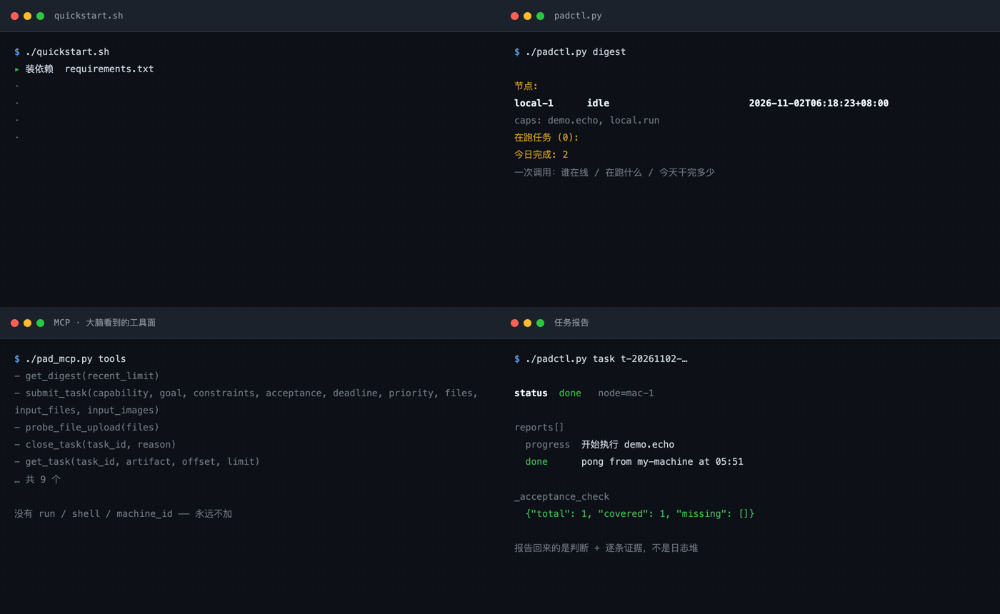
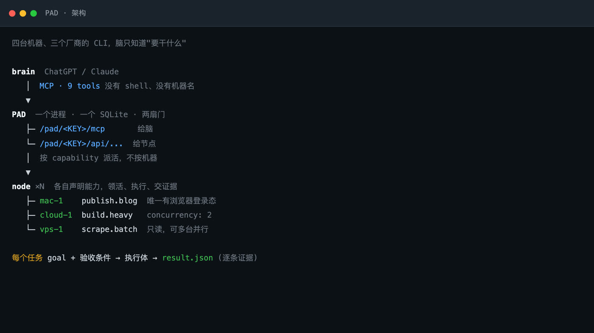
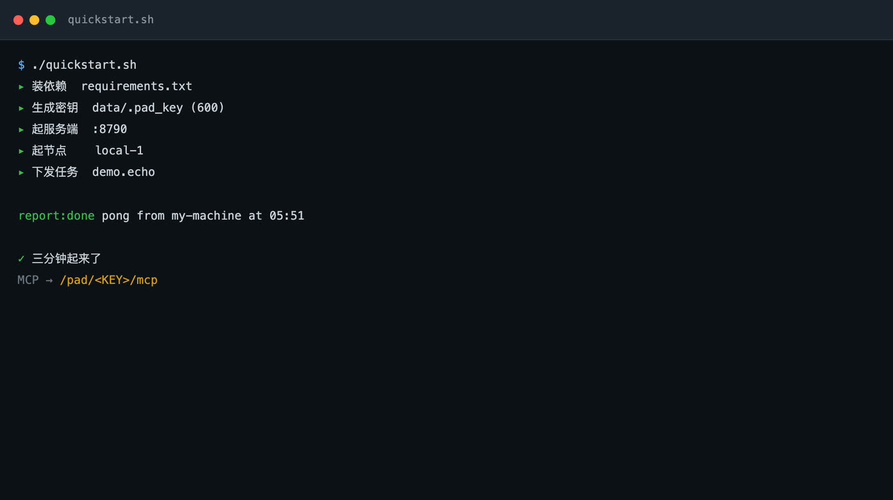
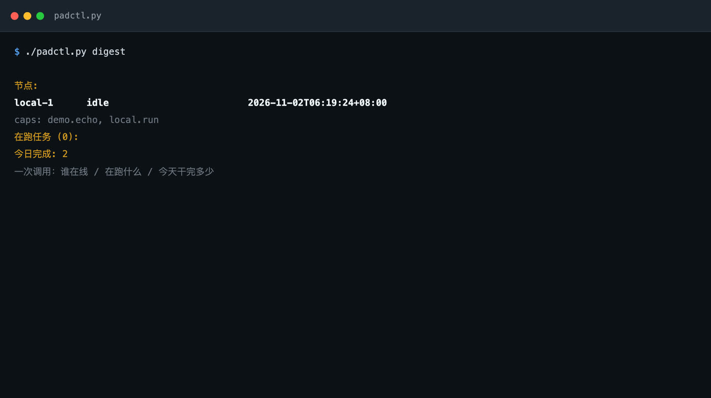
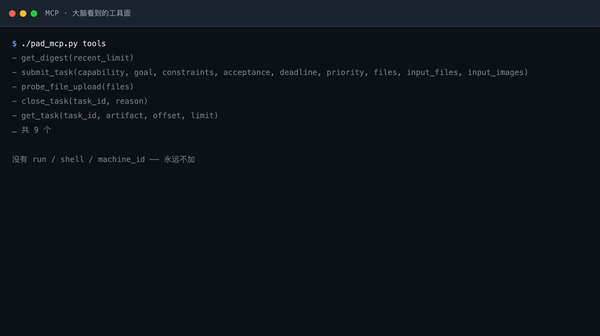

# PAD

[中文](README.md) · [English](README.en.md) · **Français** · [日本語](README.ja.md) · [Русский](README.ru.md)

**Transformez les machines que vous possédez déjà en une flotte d'exécution que ChatGPT ou Claude peut piloter.**
Un processus, un fichier SQLite, deux portes — le modèle est sans état, l'état vit dans PAD.



<sub>Les quatre panneaux sont des images d'une exécution réelle : `./quickstart.sh` qui s'allume ligne par ligne, `padctl digest`, la surface d'outils MCP et un rapport de tâche. Générés par `docs/make_preview.py` à partir de la sortie réelle de cette machine — pas une maquette.</sub>

**Article** : [`paper/pad.pdf`](paper/pad.pdf) — un rapport système sur 6 machines, 938 tâches réelles et 835 heures-machine, au format ICML 2025.

---

```
/pad/<KEY>/mcp        pour le cerveau (ChatGPT / Claude) — 9 outils
/pad/<KEY>/api/...    pour le démon de chaque machine — enregistrement / prise / rapport
```

Le modèle ne se souvient pas de ce qu'il a fait hier, ni de la machine occupée, ni de
l'endroit où une tâche est bloquée. Il ne le peut pas, et il ne le doit pas. PAD garde
tout cela dans SQLite ; le modèle pose une question — *quelle est la situation* — reçoit
un résumé, et continue.



## Démarrage rapide

```bash
git clone https://github.com/Liam-magicbook/pad.git && cd pad
./quickstart.sh
```

En moins de trois minutes, il crée un virtualenv, installe les dépendances, génère une
clé, démarre le serveur, démarre un nœud local, envoie une vraie tâche et affiche le
rapport.



Vous obtenez une URL MCP à la fin ; collez-la dans ChatGPT et c'est terminé. Arrêt :
`./quickstart.sh --stop`.

Prérequis : Python 3.10+ et la possibilité de créer un venv. Pas de Docker, pas de
serveur de base de données.

## Le problème résolu

Vous avez trois types de travail sur trois machines : un Mac qui détient des sessions
navigateur, une machine cloud qui lance de longs builds, un petit VPS qui collecte. Vous
dites « produis le rapport » dans ChatGPT et attendez qu'il sache où l'envoyer.

**Sans PAD**, vous décrivez l'état de chaque machine dans la conversation, et le modèle
doit s'en souvenir. Nouvelle session, on recommence.

**Avec PAD**, vous dites « produis un rapport », le modèle appelle `get_digest` une fois
et voit :

```
nodes:
  mac-1       running 2 [publish:12min, build:0min]
    caps: publish.blog, build.heavy
  vps-1       idle
    caps: scrape.batch
active (2):
  t-20261102-a3f2   running   publish.blog  6 posts aujourd'hui
done today: 7
```

Il envoie alors vers `scrape.batch` parce que `vps-1` est libre — et il **n'a jamais appris
le nom d'une machine**. Ajouter, remplacer ou perdre une machine ne change rien côté modèle.



## Connecter un cerveau

MCP est la seule surface externe. Le cerveau reçoit neuf outils ; il n'y a ni `run`, ni
`shell`, ni `machine_id` :

```
get_digest(recent_limit=10)          état de la flotte
submit_task(capability, goal, …)     envoyer une tâche (fichiers facultatifs)
get_task(task_id)                    une tâche : statut + flux de rapports + artefacts
get_artifact(task_id, name, offset)  lecture paginée d'un artefact
get_input_file(task_id, name)        ouvrir un fichier envoyé avec la tâche
close_task(task_id, reason)          annuler (tue le groupe de processus local)
probe_file_upload(files)             vérification de bout en bout des pièces jointes
get_artifact_delivery / observe      lien signé et échantillonnage d'images (optionnel)
```



**ChatGPT** : Settings → Connectors (Developer mode) → Create → MCP Server URL
`http://<hôte>:8790/pad/<KEY>/mcp` → Scan tools → vérifiez l'apparition des outils.

**Claude Code / tout client MCP** :

```json
{
  "mcpServers": {
    "pad": { "type": "http", "url": "http://127.0.0.1:8790/pad/<KEY>/mcp" }
  }
}
```

Fonctionner en localhost ne signifie pas fonctionner depuis Internet. Pour un accès
mobile ou externe, voir [Déploiement](#déploiement).

## Ajouter une machine

Une machine = un nœud = un YAML. **Aucune modification du code PAD.**

```bash
# sur la nouvelle machine
export PAD_HOME=$HOME/pad-ld
BASE=http://<hôte>:8790/pad/<KEY>

mkdir -p "$PAD_HOME"
curl -fsS "$BASE/agent.bundle.tgz" | tar xz -C "$PAD_HOME"
cd "$PAD_HOME"
python3 -m venv .venv && .venv/bin/pip install -r requirements.txt

cp ld_config.node.yaml.example ld_config.yaml
vi ld_config.yaml                 # node_id / capabilities / pad_url
.venv/bin/python ld_agent.py ld_config.yaml
```

Le `agent.bundle.tgz` récupéré est le démon et les prompts **actuels** du serveur. Pas de
clone, et pas de « cette machine exécute la logique d'il y a trois mois ». Quand le
squelette serveur change, les nœuds signalent une empreinte différente à l'enregistrement
et une commande suffit à re-tirer (sans toucher à votre `ld_config.yaml`) :

```bash
curl -fsS "$BASE/agent.bundle.tgz" | tar xz -C "$PAD_HOME" && <redémarrer LD>
```

Le protocole complet, la liste d'auto-vérification et les pièges connus sont dans
[JOIN.md](JOIN.md).

### Deux façons de déclarer une capacité

```yaml
capabilities:

  # 1. déterministe : appeler une commande
  scrape.batch:
    desc: "collecte par lots, lecture seule"
    cmd: "cd ~/projects/scraper && python3 crawl.py --out $PAD_WORK_DIR/data.json"
    timeout_min: 120

  # 2. nécessite du jugement : confier à un CLI d'agent local, sans interface
  build.heavy:
    desc: "tâches de code lourdes"
    cmd: "python3 /opt/pad-ld/harness/run_harness.py opencode"
    timeout_min: 240
    concurrency: 2
```

`run_harness.py` traduit une tâche en invocation d'un CLI — **changer d'exécuteur est un
argument** : `opencode` / `claude` / `codex`. Toute l'adaptation tient dans un seul
`build_cmd()`. PAD ne sait pas quel modèle vous utilisez ; il envoie « ce qui doit
arriver », chaque nœud adapte, donc les machines peuvent différer.

Dans les deux cas le contrat est identique : terminé ou échoué, le nœud écrit
`$PAD_WORK_DIR/result.json` avec `done`/`failed`, un rapport en prose et des preuves par
critère. **Pas de `result.json` signifie non terminé**, même avec un code de sortie 0.

Un simple `echo` peut atteindre `done`, mais le serveur marquera l'acceptation comme sans
réponse (`_acceptance_check.covered=0`). Ce n'est pas un bug — le système dit honnêtement
que ce rapport ne peut pas se prouver. Enveloppez-le dans `harness/run_script.py` pour
obtenir un `result.json` standard à partir de stdout, du code de sortie et de la fin du
journal.

### À se demander avant d'ajouter une capacité

> Si deux machines faisaient cela en même temps, se marcheraient-elles dessus ?

| Réponse | Que faire |
|---|---|
| **Oui** (état de connexion partagé, même fichier de sortie, même ressource) | **Une seule** peut la déclarer |
| **Non** (collecte, tests, lectures pures) | Déclarer le **même nom** sur plusieurs nœuds — c'est la montée en charge horizontale |

Ne renommez jamais une capacité conflictuelle pour contourner la règle. Le hub la traiterait
comme un autre travail et en enverrait une à chacune — le conflit ne disparaît pas, il se cache.

## Déploiement

Localhost ne suffit pas pour un téléphone, un autre réseau ou le cloud de ChatGPT. Trois couches :

```
internet → proxy inverse (nginx/caddy, TLS) → 127.0.0.1:8790 (uvicorn)
```

Les points qui font mal (chacun nous a coûté une session de débogage) :

| Élément | Note |
|---|---|
| **`PAD_ALLOWED_HOSTS`** | Liste d'autorisation anti-DNS-rebinding de MCP, comparée **littéralement à l'en-tête `Host`, port inclus**. Un hôte absent renvoie 421 alors que REST renvoie toujours 200 — très difficile à diagnostiquer |
| **`PAD_KEY`** | C'est *l'* authentification. Elle est dans l'URL : traitez-la comme un secret révocable de longue durée. Ne la collez pas en public |
| **Limite de corps du proxy** | Les valeurs par défaut sont faibles ; les tâches avec fichiers renvoient 413. Réglez `client_max_body_size 32m` sur l'emplacement `/pad/` |
| **Ne pas redémarrer le serveur** | `systemctl restart pad` tue les groupes de processus des tâches en cours. Redémarrez dans une fenêtre calme |

```bash
# serveur
PAD_KEY=$(cat data/.pad_key) \
PAD_DB=/var/lib/pad/pad.db \
PAD_ALLOWED_HOSTS=pad.example.com,localhost,127.0.0.1 \
.venv/bin/python -m uvicorn server:app --host 127.0.0.1 --port 8790
```

Les unités systemd sont dans `deploy/pad.service` et `deploy/pad-node.service` (Linux),
plus `deploy/com.pad.ld.plist` (macOS). Chaque `CHANGE_ME` est marqué.

## Envoyer des fichiers avec une tâche

Le modèle ne doit pas fourrer des mégaoctets de base64 dans son contexte. Deux chemins :

**1. `files` (pièces jointes ChatGPT)** — l'utilisateur joint un fichier dans la
conversation ; ChatGPT le convertit via `_meta["openai/fileParams"]` en
`{download_url, file_id, mime_type, file_name}`, et le serveur récupère les octets
**pendant cet appel**. Le modèle ne touche jamais le contenu.

**2. `input_files`** — quand l'appelant a déjà les octets : `{name, mime_type, data_base64}`.

Les deux partagent la même validation et le même stockage (8 fichiers par tâche, ≤10 Mio
chacun, ≤15 Mio au total). Le nœud voit les fichiers originaux plus `manifest.json` avec
sha256 dans `inputs/`. Tout type : images, PDF, Office, CSV/JSON/Markdown, archives, audio,
vidéo, sous-titres.

Sans écrire du base64 à la main :

```bash
./padctl.py submit --capability build.heavy --goal "revoir le plan selon ce rapport" \
  --file ~/Downloads/rapport-trimestriel.pdf --file ~/Downloads/donnees.xlsx
./padctl.py inputs t-20261102-xxxxxx          # quels fichiers cette tâche porte
./padctl.py input  t-20261102-xxxxxx --out .  # télécharger et vérifier
```

**`download_url` n'est valide que pendant cet appel** : les octets doivent être récupérés de
manière synchrone ; « stocker l'URL dans la tâche et laisser le nœud tirer plus tard »
expire toujours. Le chemin de téléchargement est traité comme du SSRF : https uniquement,
la résolution DNS rejette les plages privées/boucle locale/réservées, **chaque saut de
redirection est revalidé** (le suivi automatique est désactivé — un seul 302 contournerait
le blocage), et les lectures sont comptées par rapport à la limite de taille.

## Choix délibérés

**Router par capacité, jamais par machine.** Le modèle dit « je veux que `build.heavy` soit
fait », pas « lance ceci sur gpu-1 ». Celui qui offre cette capacité la prend. La structure
de tâche n'a **aucun** `machine_id`, `command` ou `shell` — et n'en aura jamais.

**Un objectif est un résultat, pas une procédure.** Le cerveau et l'exécuteur reçoivent la
même phrase : ce qui est voulu, où est la limite, comment le succès est jugé. L'exécuteur
décompose, explore et vérifie ; bloqué, il tente un autre chemin au lieu de demander « et
maintenant ? ». S'il ne peut vraiment pas finir, il livre un rapport `failed` complet.

**L'annulation doit atteindre le plan d'exécution.** Si `close_task` ne change que l'état
dans PAD, on obtient « le plan de contrôle le croit mort, le plan d'exécution tourne
toujours » — un emplacement est retenu en otage et rien derrière ne peut démarrer. Cela
vient d'un incident réel : les nœuds interrogent le statut pendant l'exécution et tuent
tout le groupe de processus sur `cancelled`, en refusant de soumettre un `done` tardif.

**Un délai d'attente n'est pas une annulation.** Après un délai de session souple, un
descendant peut encore faire un travail valide : nous le traitons comme un bail et
récoltons le résultat s'il arrive. Seul un `cancelled` explicite tue des processus.

**Les rapports doivent se prouver.** `done` et `failed` portent des preuves par critère ; le
serveur calcule la couverture (`_acceptance_check.missing` nomme ce qui est resté sans
réponse). Il juge seulement *si un critère a été traité*, jamais si la réponse est vraie —
la vérité vient d'un nœud réviseur indépendant.

**Les squelettes deviennent obsolètes, d'où une empreinte.** Docs et prompts vivent sur le
serveur ; les nœuds en détiennent des copies qui ne se mettent pas à jour seules. `bundle.py`
hache les fichiers comportementaux et les prompts, les nœuds déclarent la leur à
l'enregistrement, et une divergence apparaît immédiatement dans la vue de situation.

## Un seul PAD, trois cerveaux : work agent et personal agent sont le même emplacement

Le mot « agent » désigne deux choses très différentes, et les confondre est pourquoi la
plupart des produits d'assistant personnel finissent difformes.

- **Work agent** — autorité bornée. Vous énoncez un résultat ; il termine dans une enveloppe déclarée.
- **Personal agent** — autorité permanente. Il décide quoi faire, quand, et avec quelles ressources.

L'industrie suppose que ces deux-là exigent deux systèmes. La réponse de PAD : **ce n'est
qu'une question de quel client occupe l'emplacement du cerveau, pas une question
d'architecture.** L'emplacement est remplaçable, et le hub y est indifférent.

| Qui occupe l'emplacement | Autorité | Point d'entrée |
|---|---|---|
| Modèle de chat | Délégation : vous demandez en prose, le modèle décide combien de tâches et quelles capacités | MCP `/mcp`, `created_by=chatgpt` |
| Vous | Directe : vous nommez une capacité et un objectif en ligne de commande | `padctl submit`, `created_by=human` |
| Planificateur | Périodique : envoie le même pipeline chaque jour | minuteur interne, `created_by=daily-auto-timer` |

Les trois passent par le **même** `submit_task`, écrivent dans la **même** table `tasks`,
franchissent le **même** portail d'acceptation et apparaissent dans le **même** digest. Rien
en aval ne branche sur `created_by`. C'est ce que « cerveau sans état » veut vraiment dire :
**le cerveau n'est pas un composant, c'est un rôle**, et tout client satisfaisant le
protocole peut le tenir.

Deux mois en production, la distribution réelle des trois cerveaux sur un hub :

| | Modèle de chat | Vous | Planificateur |
|---|---|---|---|
| tâches | 854 | 39 | 36 |
| terminées | 680 | 36 | 19 |
| échouées | 111 | 2 | 17 |
| couverture des preuves | 96% | 47% | 100% |
| durée médiane | 14,6 min | 0,7 min | 341 min |
| heures-machine | 632,9 | 6,9 | 194,4 |
| longueur médiane d'objectif | 301 car. | 131 car. | 611 car. |
| avec critères d'acceptation | 98% | 79% | 100% |
| capacités touchées | 12 | 8 | 1 |

Ce tableau est la preuve la plus solide de la conception. **Trois directions se séparent d'un coup :**

- Le travail confié au modèle est **spécifié** : objectifs de 301 caractères, 98% portant des
  critères, répartis sur 12 capacités.
- Le travail que vous soumettez à la main est **dirigé** : objectifs de 131 caractères, 79%
  avec critères, médiane sous la minute, 6,9 heures-machine au total sur deux mois.
- Le planificateur est à l'autre extrême : 1 capacité, les objectifs les plus longs, un
  **taux d'échec de 47%** — un pipeline fixe sans surveillance, sans personne pour
  remarquer que sa cible a bougé.

**Basculer est gratuit et sans migration.** Sur 46 jours actifs, 10 contiennent des tâches du
modèle de chat et de vous. Un travail bien compris dont le résultat est une commande, vous
l'envoyez vous-même ; un travail exigeant recherche, décomposition ou une séquence de
soumissions va au modèle. Les deux laissent la même piste d'audit, donc l'enregistrement ne
se coupe pas quand le mode change.

**L'autorité est une question de degré, pas deux systèmes.** Ce qui sépare un work agent
prudent d'un personal agent décontracté n'est ni un bac à sable ni un jeu d'outils — c'est
**quelle part de l'enveloppe est fixée à l'avance**. Une interaction `padctl` épingle
capacité, objectif et critères, chaque champ décidé par un humain. Le modèle de chat a les
mêmes neuf outils et le même plafond, mais il envoie plusieurs soumissions et choisit les
capacités lui-même — d'où des objectifs plus de deux fois plus longs (301 contre 131
caractères). Plus de délégation, plus de spécification.

**Plus d'autonomie est une modification YAML, pas un changement d'architecture.** Le mode
assistant personnel, c'est PAD plus un client qui soumet fréquemment, tient une longue
session et se voit confier une large liste de capacités. Pas une ligne du hub ne change ;
ce qui change est **quelles capacités vous déclarez**. C'est l'endroit délibéré de la
décision : elle reste explicite et révocable au lieu d'être enfouie dans le prompt d'un agent.

**Mais l'autonomie a un coût que les données énoncent clairement.** Le même mécanisme qui
rend le basculement gratuit rend la sur-délégation facile : un modèle tenant une large liste
de capacités soumettra volontiers un objectif qu'aucune capacité ne peut satisfaire, et le
hub enregistre consciencieusement un échec. Environ la moitié de la taxonomie d'échecs est
de cette forme. **Si l'autorité de routage avait été donnée au modèle, ce système n'aurait
pas pu produire de taxonomie d'échecs du tout** — il n'y aurait aucun endroit unique
enregistrant ce qui a mal tourné.

## Coordination multi-machines sans coordinateur

L'objection naturelle à un hub est que centralisé signifie goulot d'étranglement. PAD est
**centralisé en état, décentralisé en exécution**, et cette distinction explique pourquoi six
machines coopèrent sans processus planificateur.

Le hub n'a aucun travailleur de file et n'exécute rien. À chaque interrogation il répond à
deux questions : **y a-t-il du travail correspondant aux capacités que j'ai déclarées**, et
**quel est l'état du travail que je détiens**. Chaque nœud interroge à son propre rythme et
ne prend que s'il a un emplacement libre. Le débit est la somme de décisions locales, pas la
sortie d'un planificateur global.

**Il n'y a aucune étape d'affectation.** Le travail est **pris**, pas distribué. La table de
routage du hub est un ensemble de déclarations, pas un ensemble de décisions. Quatre
propriétés en découlent, chacune retirant une machine qu'un orchestrateur classique exige :

- **Pas de planificateur, pas de consensus.** Le travail est pris dans une table indexée par
  capacité ; le hub n'a besoin d'aucune vue globale de charge et d'aucun accord sur qui doit
  faire quoi. Ajouter une machine est un enregistrement ; en retirer une est un délai.
- **La contre-pression est automatique.** Un nœud déclarant `concurrency: N` ne prendra pas
  la (N+1)-ième. La file grandit dans la base de données — là où elle est visible — pas dans
  la mémoire d'un broker.
- **L'échec est local.** Un nœud qui meurt en cours de tâche laisse la tâche en `running`
  jusqu'à expiration du bail ; les rapports sont en ajout seul et idempotents, donc le
  prochain détenteur de cette capacité reprend depuis le registre.
- **Le registre de coordination est le registre d'audit.** Chaque prise, rapport et artefact
  est une ligne. C'est pourquoi la taxonomie d'échecs n'a demandé aucune instrumentation
  supplémentaire.

Le coût est réel et annoncé : un hub est un point unique de coordination, et un redémarrage
abandonne la supervision des processus en cours. Pour un opérateur avec quelques machines,
l'échange est manifestement correct ; pour du multi-tenant il ne l'est pas, et PAD ne le
prétend pas.

## Arborescence

| Fichier | Rôle |
|---|---|
| `server.py` | Serveur (FastAPI + MCPServer + SQLite) ; les deux portes |
| `db.py` / `schema.sql` | Couche d'état |
| `ld_agent.py` | Démon de nœud sur chaque machine |
| `harness/run_harness.py` | Traduit une tâche en appel sans interface opencode / claude / codex |
| `harness/run_script.py` | Enveloppe une commande dans le contrat PAD (travail déterministe) |
| `harness/prompt.md.tmpl` | Prompt de l'exécuteur. Changez les règles uniquement ici |
| `padctl.py` | CLI humaine (gère aussi `--file`) |
| `pad_mcp.py` | Client de débogage via MCP (même chemin que le cerveau) |
| `quickstart.sh` | Démarrage en une commande |
| `contract.md` | Le contrat : base de distribution, format de rapport, discipline |
| `JOIN.md` | Protocole d'adhésion + auto-vérifications + pièges |
| `CHANGELOG.md` | Changements de comportement ; à consulter en premier |
| `docs/make_preview.py` | Régénérer le GIF d'accueil (sortie réelle → images → ffmpeg) |
| `paper/` | Rapport système (format ICML, `pad.pdf`) + mesures agrégées |
| `tools/collect_stats.py` | Extraire les détails de tâches d'un PAD en production |

## Développement

```bash
.venv/bin/python -m unittest discover -s tests -v   # tests unitaires
bash tests/e2e_input_files.sh                       # bout en bout : serveur + nœud temporaires
```

Les images de démonstration ne sont pas assemblées à la main ; elles capturent la sortie
réelle de cette machine puis la photographient. À relancer après un changement de format :

```bash
./quickstart.sh          # un PAD local doit tourner
.venv/bin/python docs/make_preview.py
```

## Article

`paper/pad.pdf` (format ICML 2025, 8 pages de corps + 5 d'annexe) transforme ce qui précède en
rapport système citable : définition du problème, relation aux travaux sur les harness /
long-horizon / délégation, architecture, principes de conception, et mesures. L'annexe détaille
le schéma de base, la machine d'états des tâches, le contrat de chacun des neuf outils et les
scripts de reproduction. Seul le PDF final est publié ; les sources LaTeX
restent locales.

Les mesures viennent de deux mois de journaux réels de ce système en production :

| Métrique | Valeur |
|---|---|
| Nœuds / capacités | 6 machines, 20 capacités, CLI d'agents de 3 éditeurs |
| Tâches réelles (hors auto-vérifications) | 938, 835 heures-machine |
| Tâches longues | 18,7% de plus d'une heure, 25 de plus de 6 heures, la plus longue 42 heures |
| Preuves par critère sur tâches terminées | 93% |
| Tâches échouées livrant quand même un rapport structuré | 42% |
| Cause d'échec dominante | 64/132 sont des défauts d'environnement d'exécution (pas le modèle) |

Cette dernière ligne est l'argument de toute la conception : **la plupart des échecs arrivent
dans l'environnement, pas dans le raisonnement.** Un harness à boucle unique voit « l'appel
d'outil a cassé » ; PAD voit « cette capacité sur cette machine est cassée », et c'est la
seconde qui est réparable.

Données et scripts de reproduction : `paper/data/aggregates.json` et `tools/collect_stats.py`.
L'export brut contient de vrais objectifs d'opérateur et n'est pas dans le dépôt.

## Lacunes connues

- L'authentification est une clé d'URL, sans OAuth. Passer à OAuth signifie changer la couche devant le proxy ; le contrat reste
- Une tâche qui plante en `running` (sans rapport terminal) n'est pas reprise automatiquement ; il faut un reaper
- La limite de 10 Mio par fichier vient du tampon en mémoire du serveur ; des centaines de Mio exigeraient des écritures par morceaux
- Les entrées non-image ne sont pas analysées dans PAD (pas d'extraction de texte PDF, pas de conversion Office) ; l'exécuteur du nœud les lit avec les outils locaux
- La publication d'espace de travail ChatGPT Business/Enterprise n'est pas implémentée ; seul le mode développeur personnel l'est

---

MIT License
