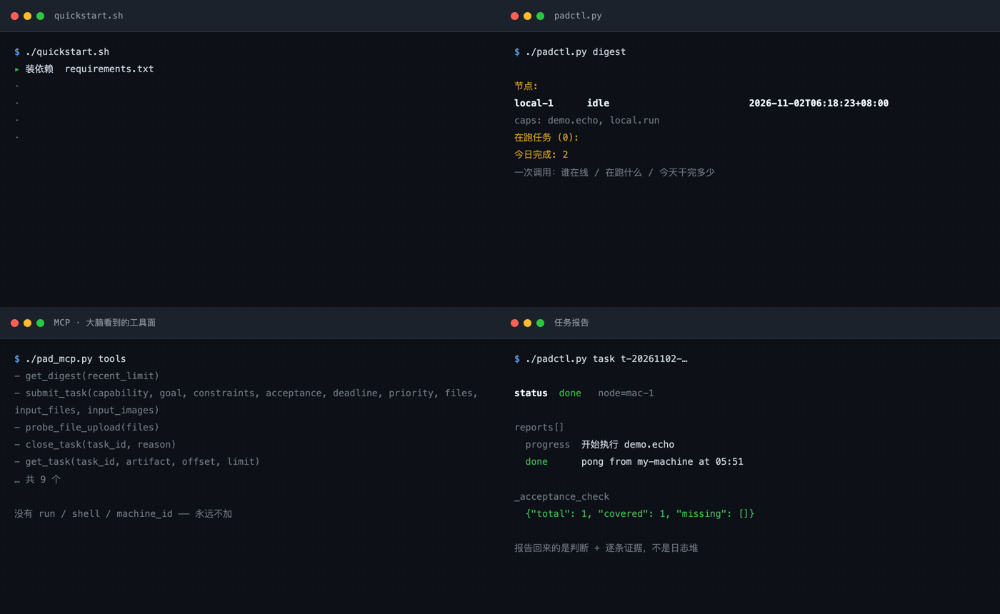
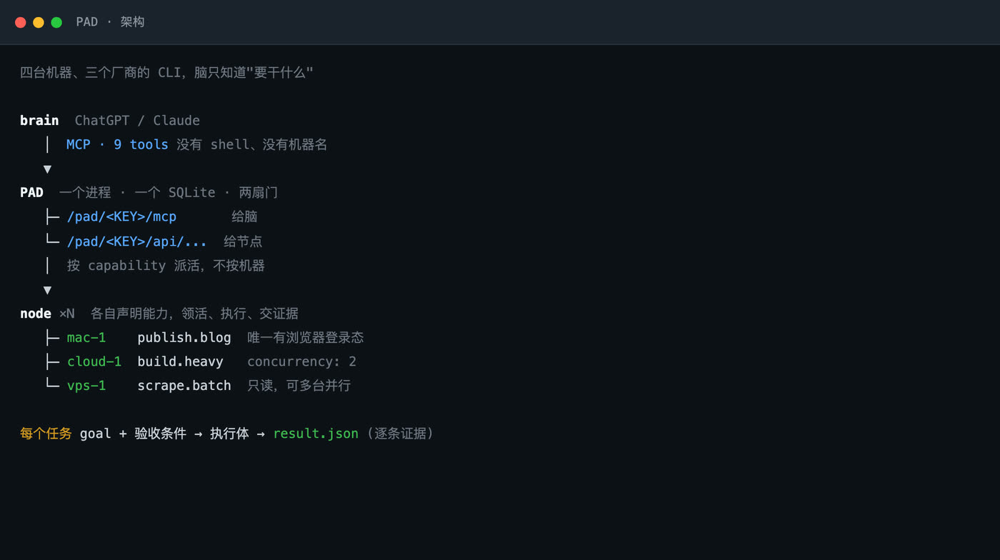
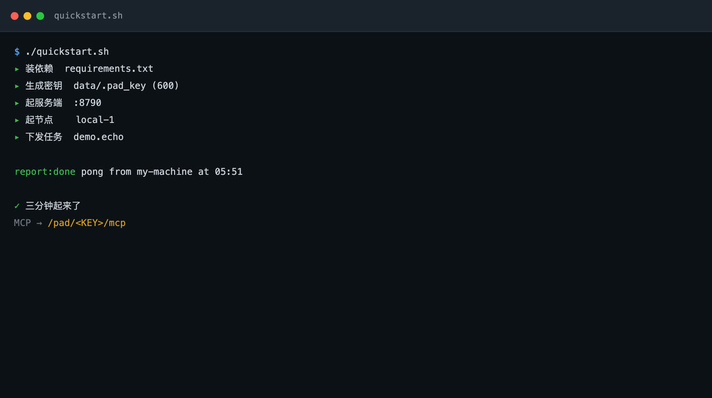
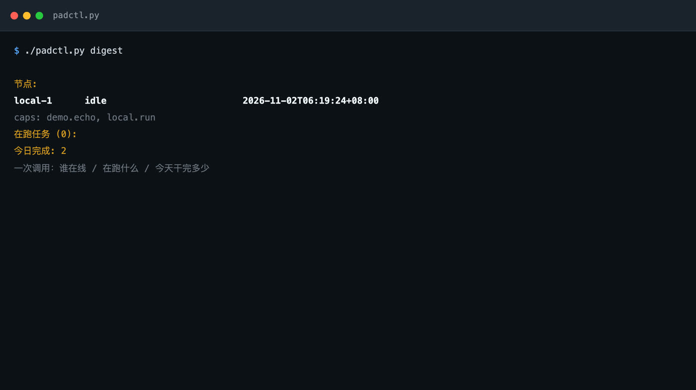
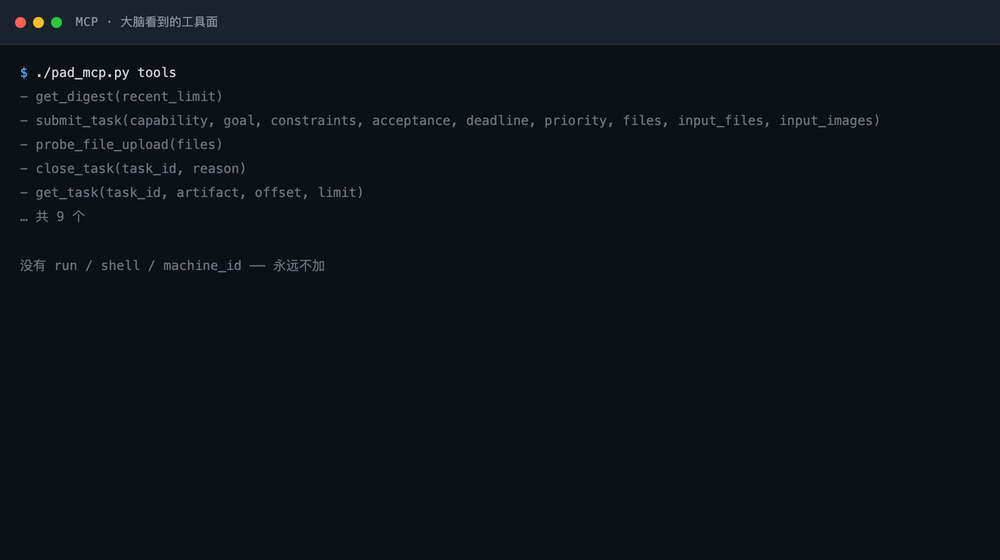

# PAD

[中文](README.md) · [English](README.en.md) · [Français](README.fr.md) · **日本語** · [Русский](README.ru.md)

**手持ちのマシンを、ChatGPT / Claude が指揮できる実行クラスタに変える。**
1 プロセス、1 つの SQLite、2 つの入口 — モデルは無状態、状態はすべて PAD にある。



<sub>4 パネルはいずれも実実行のフレーム：`./quickstart.sh` が 1 行ずつ点灯する様子、`padctl digest`、MCP ツール面、タスク報告。`docs/make_preview.py` がこのマシンの実際の出力から生成したもので、モックアップではない。</sub>

**論文**：[`paper/pad.pdf`](paper/pad.pdf) — 6 台のマシン、938 件の実タスク、835 マシンアワーの実証報告（ICML 2025 組版）。

---

```
/pad/<KEY>/mcp        脳（ChatGPT / Claude）向け — 9 個のタスクツール
/pad/<KEY>/api/...    各マシンのノードデーモン向け — 登録 / 取得 / 報告
```

モデルは昨日何をしたか、どのマシンが動いているか、タスクがどこで詰まっているかを覚えていない。
覚えられないし、覚えるべきでもない。PAD がそれを SQLite に置き、モデルは「今どうなっているか」を
一度訊いて要約を受け取り、また指示を続ける。



## クイックスタート

```bash
git clone https://github.com/Liam-magicbook/pad.git && cd pad
./quickstart.sh
```

3 分以内に、仮想環境の作成 → 依存関係のインストール → 鍵の生成 → サーバー起動 → ローカルノード起動
→ 実タスクの投入 → レポート出力まで進む。



最後に MCP の URL が得られるので、ChatGPT に貼れば使える。停止は `./quickstart.sh --stop`。

要件：Python 3.10 以上、venv が作れること。Docker もデータベースサーバーも不要。

## 何を解決するか

3 台のマシンで 3 種類の仕事を回している：ブラウザのログイン状態を持つ Mac、長時間ビルドを回す
クラウド機、データ収集専用の小さな VPS。ChatGPT に「レポートを出して」と言って、どこに振るべきかを
分かってほしい。

**PAD がなければ**、会話の中で各マシンの状態を説明し、モデルに覚えさせることになる。新しいセッション
では全部やり直し。

**PAD があれば**、「レポートを出して」と言うだけで、モデルは `get_digest` を 1 回呼び、こう見る：

```
nodes:
  mac-1       running 2 [publish:12min, build:0min]
    caps: publish.blog, build.heavy
  vps-1       idle
    caps: scrape.batch
active (2):
  t-20261102-a3f2   running   publish.blog  本日 6 件
done today: 7
```

そして `scrape.batch` に振る。`vps-1` がたまたま空いているからだ — そして**マシン名は一切知らない**。
マシンの追加・入れ替え・消失があっても、モデル側は 1 行も変わらない。



## 脳をつなぐ

外部に晒す面は MCP だけ。脳が持つツールは 9 個で、`run` も `shell` も `machine_id` もない：

```
get_digest(recent_limit=10)          フリート状況：誰が生きているか、何が動いているか、本日の完了数
submit_task(capability, goal, …)     タスク投入（ファイル添付可）
get_task(task_id)                    単一タスク：状態 + 報告ストリーム + 成果物
get_artifact(task_id, name, offset)  成果物のページ読み
get_input_file(task_id, name)        タスクと一緒に送られたファイルを開く
close_task(task_id, reason)          キャンセル（ローカルのプロセスグループを実際に殺す）
probe_file_upload(files)             添付経路のエンドツーエンド検証
get_artifact_delivery / observe      署名付きリンクとフレーム抽出（任意の拡張）
```



**ChatGPT**：Settings → Connectors（Developer mode）→ Create → MCP Server URL に
`http://<ホスト>:8790/pad/<KEY>/mcp` → Scan tools → 上記ツールが出ることを確認。新しい会話で
ツールメニューから PAD を有効にする。

**Claude Code / その他の MCP クライアント**：

```json
{
  "mcpServers": {
    "pad": { "type": "http", "url": "http://127.0.0.1:8790/pad/<KEY>/mcp" }
  }
}
```

ローカルで通ったからといって外部から使えるわけではない。スマホや別ネットワークからの利用は
[公開](#公開) を参照。

## マシンを追加する

1 台 = 1 ノード = 1 YAML。**PAD のコード変更は不要。**

```bash
# 新しいマシンで
export PAD_HOME=$HOME/pad-ld
BASE=http://<ホスト>:8790/pad/<KEY>

mkdir -p "$PAD_HOME"
curl -fsS "$BASE/agent.bundle.tgz" | tar xz -C "$PAD_HOME"
cd "$PAD_HOME"
python3 -m venv .venv && .venv/bin/pip install -r requirements.txt

cp ld_config.node.yaml.example ld_config.yaml
vi ld_config.yaml                 # node_id / capabilities / pad_url
.venv/bin/python ld_agent.py ld_config.yaml
```

取得する `agent.bundle.tgz` はサーバーの**現在の**ノードデーモンとプロンプト。クローン不要で、
「この箱は 3 か月前のロジックを動かしている」ということも起きない。サーバー側の骨格が変わると、
ノードは登録時に指紋の不一致を報告し、1 コマンドで取り直せる（`ld_config.yaml` は触らない）：

```bash
curl -fsS "$BASE/agent.bundle.tgz" | tar xz -C "$PAD_HOME" && <LD を再起動>
```

参加プロトコル、自己点検リスト、既知の罠は [JOIN.md](JOIN.md) にある。

### 能力の 2 通りの書き方

```yaml
capabilities:

  # ① 決定的な仕事：コマンドを直接呼ぶ
  scrape.batch:
    desc: "バッチ収集、読み取り専用"
    cmd: "cd ~/projects/scraper && python3 crawl.py --out $PAD_WORK_DIR/data.json"
    timeout_min: 120

  # ② 判断が要る仕事：ローカルの agent CLI にヘッドレスで任せる
  build.heavy:
    desc: "重量級のコード作業"
    cmd: "python3 /opt/pad-ld/harness/run_harness.py opencode"
    timeout_min: 240
    concurrency: 2
```

`run_harness.py` はタスクをいずれかの CLI 呼び出しに翻訳する — **実行体の差し替えは引数 1 つ**：
`opencode` / `claude` / `codex`。適応コードはすべて `build_cmd()` 1 つ。PAD はあなたが使うモデルを
知らない。「何が起きるべきか」を送り、適応はノード側で行う。だからマシンごとに違ってよい。

どちらの書き方でも契約は同じ：完了でも失敗でも、ノードは `$PAD_WORK_DIR/result.json` に
`done` / `failed`、散文の報告、基準ごとの証拠を書く。**`result.json` がなければ完了ではない**、
終了コードが 0 でも同じ。

素の `echo` でも `done` には到達できるが、サーバーは「検収未回答」を付ける
（`_acceptance_check.covered=0`）。壊れているのではなく、この報告は自分を証明できないと正直に
言っているだけ。証拠が要るなら `harness/run_script.py` で包み、stdout・終了コード・ログ末尾を
標準の `result.json` にまとめる。

### 能力を足す前に問うこと

> 2 台が同時にこれをやったら、ぶつかるか？

| 答え | どうする |
|---|---|
| **ぶつかる**（ログイン状態の共有、同じ出力ファイル、同じ資源） | **1 台だけ**が宣言できる |
| **ぶつからない**（収集、テスト、純粋な読み取り） | 複数台が**同じ名前**で宣言する — これが水平スケール |

衝突を避けるために別名を付けてはいけない。上位は別の仕事と見なし、両方に 1 件ずつ振る。
衝突は消えず、隠れるだけ。

## 公開する

ローカルの `127.0.0.1` ではスマホも別ネットワークも ChatGPT のクラウドも届かない。3 層が要る：

```
インターネット → リバースプロキシ（nginx/caddy、TLS）→ 127.0.0.1:8790（uvicorn）
```

実際に踏んだ落とし穴（いずれもデバッグ 1 セッション分の代償）：

| 項目 | 説明 |
|---|---|
| **`PAD_ALLOWED_HOSTS`** | MCP の DNS リバインディング対策ホワイトリスト。**`Host` ヘッダ（ポート含む）と逐語一致**。載っていないホストは 421 を返すのに REST は 200 のまま — 極めて特定しにくい |
| **`PAD_KEY`** | これが認証そのもの。URL に載るので、失効可能な長期鍵として扱う。公開の場に貼らない |
| **プロキシの body 上限** | 既定は小さく、ファイル付きタスクは 413。`/pad/` の location だけ `client_max_body_size 32m` に |
| **サーバーを再起動しない** | `systemctl restart pad` は走行中のタスクのプロセスグループを殺す。空いている時間帯に再起動する |

```bash
# サーバー
PAD_KEY=$(cat data/.pad_key) \
PAD_DB=/var/lib/pad/pad.db \
PAD_ALLOWED_HOSTS=pad.example.com,localhost,127.0.0.1 \
.venv/bin/python -m uvicorn server:app --host 127.0.0.1 --port 8790
```

systemd ユニットは `deploy/pad.service` と `deploy/pad-node.service`（Linux）、
`deploy/com.pad.ld.plist`（macOS）。`CHANGE_ME` の箇所はすべて明示してある。

## タスクと一緒にファイルを送る

モデルが数 MB の base64 をコンテキストに詰め込んではいけない。経路は 2 つ：

**① `files`（ChatGPT の添付）** — 利用者が会話で添付すると、ChatGPT が
`_meta["openai/fileParams"]` 経由で `{download_url, file_id, mime_type, file_name}` に変換し、
サーバーが**その呼び出しの中で**バイト列を取得する。モデルは中身に一切触れない。

**② `input_files`** — 呼び出し側が既にバイト列を持つ場合：`{name, mime_type, data_base64}`。

両者は同じ検証・保存経路を共有する（1 タスク 8 個まで、1 個 ≤10 MiB、合計 ≤15 MiB）。ノードは
`inputs/` に元ファイルと sha256 入りの `manifest.json` を得る。型は問わない：画像、PDF、Office、
CSV/JSON/Markdown、アーカイブ、音声、動画、字幕。

base64 を手で作らずに：

```bash
./padctl.py submit --capability build.heavy --goal "この報告書に沿って案を直す" \
  --file ~/Downloads/四半期報告.pdf --file ~/Downloads/データ.xlsx
./padctl.py inputs t-20261102-xxxxxx          # このタスクが持つファイル
./padctl.py input  t-20261102-xxxxxx --out .  # ダウンロードして確認
```

**`download_url` はその呼び出しの間だけ有効**なので、同期的に取得する必要がある。「URL をタスクに
保存してノードが後で取りに行く」は必ず期限切れになる。この経路は SSRF として扱う：https のみ、
DNS 解決後にプライベート/ループバック/予約アドレスを拒否、**リダイレクトの各ホップを再検証**
（自動追従は無効化 — 302 が 1 つあれば回避できてしまう）、読み取りはサイズ上限まで数える。

## 意図的な設計選択

**マシンではなく能力で振る。** モデルは「`build.heavy` を片付けてほしい」と言い、「gpu-1 でこれを
実行」とは言わない。その能力を申告した者が取る。タスク構造に `machine_id` も `command` も `shell`
も**ない** — 永久に。

**goal は結果であり手順ではない。** 脳と実行体は同じ一文を受け取る：何が欲しいか、境界はどこか、
どうなったら完了か。実行体は分解し、探索し、検証する。詰まったら「次はどうする」と訊かず別経路を
探す。本当に終えられなければ `failed` の完全な報告を出す — 達成できた部分、どこで詰まったか、
証拠はどこか。

**キャンセルは実行面まで届かなければならない。** `close_task` が PAD 内の状態を変えるだけだと
「制御面は死んだと思っている、実行面はまだ走っている」になる — 実行スロットを占有し、後続が
入ってこられない。これは実際の事故から来ている：ノードは実行中に状態をポーリングし、`cancelled`
を見たらプロセスグループ全体を殺し、遅れて届く `done` を提出しない。

**タイムアウトはキャンセルではない。** ソフトなセッションタイムアウト後も子孫プロセスが有効な仕事を
していることがあるので、lease として扱い結果が届けば取り込む。殺すのは明示的な `cancelled` だけ。

**報告は自分を証明できなければならない。** `done` / `failed` の双方が基準ごとの証拠を持ち、
サーバーがカバレッジを計算する（`_acceptance_check.missing` が未回答項目を示す）。判定するのは
*基準に答えたか*だけで、答えが真かは判定しない — 真偽は独立したレビューノードが担う。生データは
統計のみを残してローカルに置くが、上位が明示的に指名したフィールドは 1 文字も省略しない。

**骨格は古くなるので指紋を持つ。** ドキュメントとプロンプトはサーバーにあり、ノードはコピーを持つので
自動更新されない。`bundle.py` が振る舞いに関わるファイルとプロンプトをハッシュ化し、ノードが登録時に
申告、不一致は状況ビューに即座に出る。

## 1 つの PAD、3 つの脳：work agent と personal agent は同じスロット

「agent」という語はまったく別の 2 つに使われており、混同することがパーソナルアシスタント製品の
多くを歪ませている原因だ。

- **work agent** — 権限に境界がある。成果を述べれば、宣言された枠の中で終える。
- **personal agent** — 常設の権限を持つ。何を、いつ、どの資源で行うかを自分で決める。

業界はこの 2 つに 2 つのシステムが必要だと前提する。PAD の答えはこうだ：**これは脳のスロットに
どのクライアントが座るかという問題にすぎず、アーキテクチャの問題ではない。** スロットは差し替え
可能で、ハブは関知しない。

| スロットに座る者 | 権限 | 入口 |
|---|---|---|
| チャットモデル | 委譲：自然言語で頼むと、モデルがタスク数と能力を自分で決める | MCP `/mcp`、`created_by=chatgpt` |
| あなた自身 | 直接：コマンドラインで能力と目標を指名する | `padctl submit`、`created_by=human` |
| スケジューラ | 周期：毎日同じパイプラインを投入する | 内部タイマー、`created_by=daily-auto-timer` |

3 者は**同じ** `submit_task` を通り、**同じ** `tasks` テーブルに書き、**同じ**検収ゲートを通り、
**同じ** digest に現れる。下流のどこも `created_by` で分岐しない。これが「無状態の脳」の本当の
意味だ：**脳はコンポーネントではなく役割**であり、プロトコルを満たすものなら何でも座れる。

本番 2 か月、1 つのハブ上での 3 つの脳の実分布：

| | チャットモデル | あなた | スケジューラ |
|---|---|---|---|
| タスク数 | 854 | 39 | 36 |
| 完了 | 680 | 36 | 19 |
| 失敗 | 111 | 2 | 17 |
| 証拠カバレッジ | 96% | 47% | 100% |
| 中位所要時間 | 14.6 分 | 0.7 分 | 341 分 |
| マシンアワー | 632.9 | 6.9 | 194.4 |
| goal の中位長 | 301 字 | 131 字 | 611 字 |
| 検収条件あり | 98% | 79% | 100% |
| 触れた能力数 | 12 | 8 | 1 |

この表がこの設計の最も硬い証拠だ。**3 方向が同時に分かれる**：

- モデルに渡した仕事は**仕様化されている**：goal 301 字、98% が検収条件付き、12 の能力に分散。
- あなたが手で出した仕事は**指向されている**：goal 131 字、79% が条件付き、中位 1 分未満、
  2 か月で合計 6.9 マシンアワー。
- スケジューラはもう一方の極：能力 1 つ、goal は最長、**失敗率 47%** — 無人で回る固定パイプラインは、
  目標が動いたことに誰も気づかない。

**切り替えは無料で、移行も要らない。** 46 の稼働日のうち 10 日は、チャットモデルとあなたの両方の
タスクが含まれる。よく分かっていて結果が 1 コマンドの仕事は自分で出し、調査・分解・連続投入が
要る仕事はモデルに渡す。どちらも同じ監査証跡を残すので、モードが変わっても記録は 2 つに割れない。

**権限は程度の問題で、2 つのシステムではない。** 慎重な work agent と放手した personal agent を
分けるのは、サンドボックスでもツールセットでもなく、**事前に枠のどこまでを固定するか**だ。
`padctl` の 1 回のやり取りは能力・目標・検収条件を固定し、各フィールドは人間が決める。チャット
モデルは同じ 9 つのツールと同じ天井を持つが、複数の投入を連ね、能力を自分で選ぶ — だから goal は
2 倍以上長い（301 対 131 字）。委譲が多いほど、仕様は細かくなる。

**自律性を増やすのは YAML の編集で、アーキテクチャの変更ではない。** personal assistant モードとは、
PAD に、高頻度で投入し、長いセッションを保ち、広い能力リストを任されたクライアントを足したもの。
ハブは 1 行も変わらない。変わるのは**どの能力を宣言するか**だ。決定をこの位置に置くのは意図的で、
エージェントのプロンプトに埋めるのではなく、明示的で取り消し可能なままに保てる。

**しかし自律性にはコストがあり、データは明快に示す。** 切り替えを無料にするのと同じ仕組みが、
過剰な委譲を容易にする：広い能力リストを持つモデルは、どの能力でも満たせない目標を喜んで投入し、
ハブは律儀に失敗を記録する。失敗分類のおよそ半分がこの形だ。**もしルーティング権限をモデルに
与えていたら、このシステムは失敗分類をそもそも産めなかった** — どこがどう悪かったかを記録する
単一の場所が存在しなかったからだ。

## コーディネータなしのマルチマシン協調

ハブへの自然な反論は「集中化はボトルネック」だ。PAD は**状態は集中、実行は分散**であり、この区別が
6 台のマシンがスケジューラプロセスなしで協調できる理由だ。

ハブにはキューワーカーがなく、自分では何も実行しない。各ポーリングで 2 つの問いに答えるだけ：
**宣言した能力に合う仕事はあるか**、**保持している仕事の状態は何か**。各ノードは自分のリズムで
ポーリングし、空きスロットがあるときだけ取る。スループットはローカルな判断の総和であり、グローバル
スケジューラの出力ではない。

**「割り当て」という手順がそもそも存在しない。** 仕事は**取りに行かれる**のであって、配られるのでは
ない。ハブのルーティング表は決定の集合ではなく宣言の集合だ。4 つの性質が従い、それぞれが従来の
オーケストレータが必要とするマシンを 1 台ずつ省く：

- **スケジューラなし、合意なし。** 仕事は能力で索引された表から取られる。ハブはグローバルな負荷
  ビューも、「誰がやるべきか」の合意も要らない。マシンの追加は登録、削除はタイムアウト。
- **バックプレッシャは自動。** `concurrency: N` を宣言したノードは N+1 個目を取らない。キューは
  データベースの中で伸びる — 可視であるべき場所で、ブローカーのメモリの中ではない。
- **失敗は局所化する。** 途中で死んだノードはタスクを `running` のまま残し、lease が切れる。報告は
  追記式で冪等なので、その能力の次の保持者がプロセスの残骸ではなく台帳から再開する。
- **協調の記録が監査の記録。** 取得・報告・成果物はすべて 1 行。失敗分類に追加の計装が要らなかった
  のはこのためだ：スケジューラが自分のために残すデータと、監査者が要るデータは同じもの。

コストは現実的で、明示する：ハブ 1 つは単一の協調点であり、再起動は走行中タスクのプロセス監視を
失う。単独の運用者と数台のマシンなら、この取引は明らかに正しい。マルチテナントでは正しくなく、
PAD はそこを主張しない。

## 構成

| ファイル | 役割 |
|---|---|
| `server.py` | サーバー（FastAPI + MCPServer + SQLite）。2 つの入口はここ |
| `db.py` / `schema.sql` | 状態層 |
| `ld_agent.py` | 各マシンで動くノードデーモン |
| `harness/run_harness.py` | タスクを opencode / claude / codex のヘッドレス呼び出しに翻訳 |
| `harness/run_script.py` | コマンドを PAD 契約に収める（決定的な仕事向け） |
| `harness/prompt.md.tmpl` | 実行体プロンプト。ルールを変えるのはここだけ |
| `padctl.py` | 人間用 CLI（`--file` も扱う） |
| `pad_mcp.py` | MCP 経由のデバッグツール（脳と同じ経路） |
| `quickstart.sh` | ワンコマンド起動 |
| `contract.md` | 契約：投入基準、報告形式、実行規律 |
| `JOIN.md` | 参加プロトコル + 自己点検 + 罠一覧 |
| `CHANGELOG.md` | 振る舞いが変わった事柄。デバッグ時はまずここ |
| `docs/make_preview.py` | ヒーロー GIF の再生成（実出力 → フレーム → ffmpeg） |
| `paper/` | システム報告（ICML 組版、`pad.pdf`）+ 集計のみの実測データ |
| `tools/collect_stats.py` | 稼働中の PAD からタスク詳細を取得し論文の数字を再現 |

## 開発

```bash
.venv/bin/python -m unittest discover -s tests -v   # 単体テスト
bash tests/e2e_input_files.sh                       # E2E：一時サーバー + ノードで実経路
```

デモ画像は手で組み立てたものではなく、このマシンの実際の出力を取得してから撮影している。
出力形式を変えたら再実行する：

```bash
./quickstart.sh          # ローカルの PAD が動いている必要がある
.venv/bin/python docs/make_preview.py
```

## 論文

`paper/pad.pdf`（ICML 2025 組版、本文 8 ページ + 付録 5 ページ）は上記を引用可能なシステム報告に
したもの：問題定義、harness / long-horizon / 委譲の各研究との関係、アーキテクチャ、設計原則、
そして実測。付録では DB スキーマ、タスク状態機械、9 ツールの契約、再現スクリプトを個別に展開する。リポジトリには完成した
PDF のみを公開し、LaTeX ソースはローカルに保持する。

実測はこのシステムを本番で 2 か月動かした実際のログに基づく：

| 指標 | 値 |
|---|---|
| ノード / 能力 | 6 台、20 能力、3 社の agent CLI |
| 実タスク（自己点検を除く） | 938 件、835 マシンアワー |
| 長時間タスク | 18.7% が 1 時間超、25 件が 6 時間超、最長 42 時間 |
| 完了タスクの基準ごとの証拠 | 93% |
| 失敗しても構造化報告を出した割合 | 42% |
| 失敗の主因 | 132 件中 64 件が実行体の環境問題（モデルの失敗ではない） |

最後の行がこの設計の主張そのものだ：**失敗の大半は環境で起きており、推論では起きていない。**
単一ループの harness が見るのは「ツール呼び出しが壊れた」であり、PAD が見るのは「このマシンの
この能力が壊れている」で、後者だけが直せる。

データと再現スクリプトは `paper/data/aggregates.json` と `tools/collect_stats.py`。生の取得結果には
運用者の実際の goal が含まれるためリポジトリには入れていない。

## 既知の不足

- 認証は URL 内の鍵で、OAuth はない。OAuth 化はプロキシ手前の層を差し替えるだけで、契約は変わらない
- `running` 途中で落ちた（終端報告のない）タスクは自動引き継ぎされない。stale reaper が必要
- 1 ファイル 10 MiB の上限はサーバーメモリへの一括読み込みに由来する。数百 MB は分割書き込みが必要
- 画像以外の入力は PAD 内で解析しない（PDF テキスト抽出も Office 変換もしない）。ノードの実行体がローカルツールで読む
- ChatGPT Business/Enterprise のワークスペース公開は未実装。個人の developer mode のみ

---

MIT License
