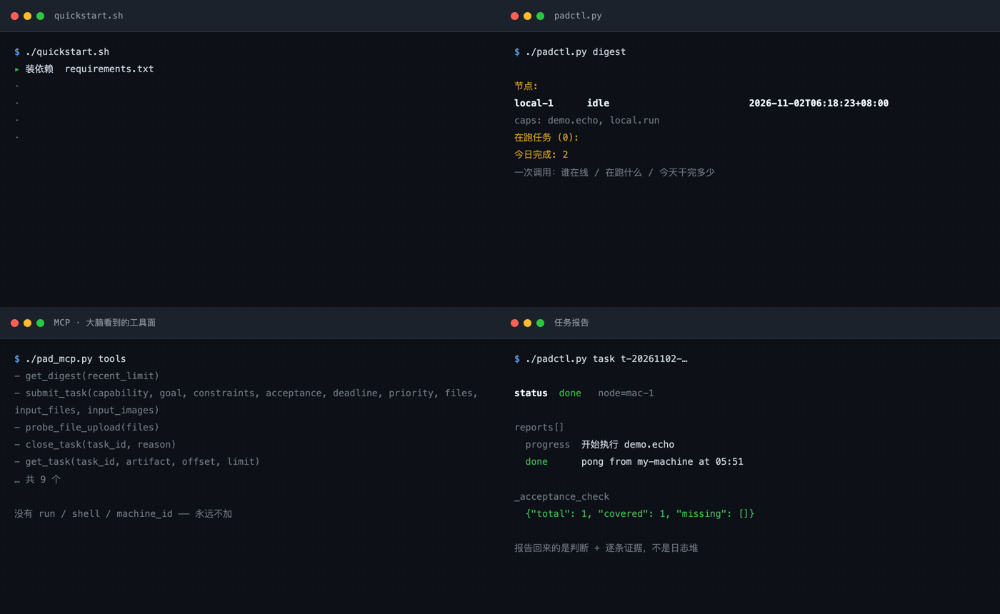
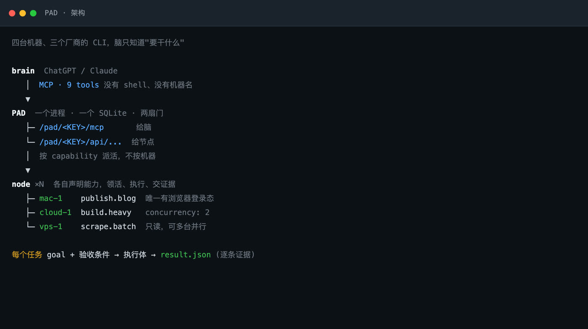
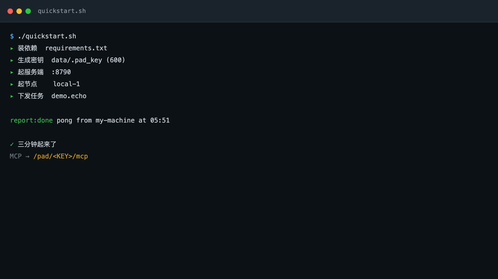
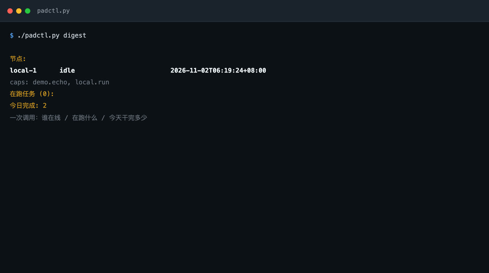
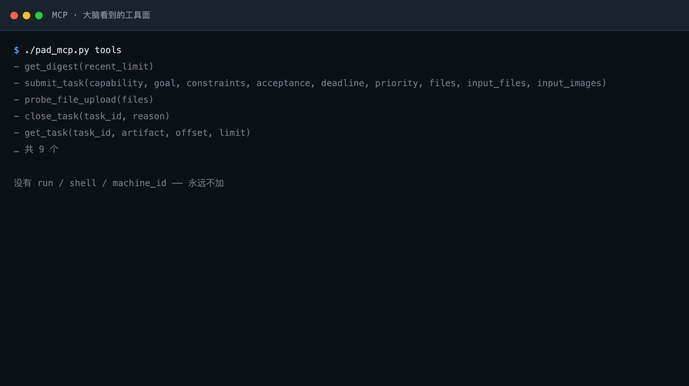

# PAD

**English** · [中文](README.zh.md) · [Français](README.fr.md) · [日本語](README.ja.md) · [Русский](README.ru.md)

**One brain, commanding work across many machines. The state sits in the middle, not in anyone's head.**

One process, one SQLite file, two doors.



<sub>All four panels are frames from a real run, generated by `docs/make_preview.py` from actual output — not a mockup.</sub>

---

## PAD is not an agent

Get this straight first, or everything after it reads wrong.

```
ChatGPT / Claude  (brain)   ← stateless; sends goals, reads results
        ↘
          PAD               ← no intelligence. Task state, routing, evidence
        ↙
  nodes × N  (one per machine)   ← does the work; declares what it can do
```

**PAD does not think and does not execute.** It does three things:

- remembers who is doing what and how far it got (task state)
- routes work to nodes that declared the matching capability (routing)
- keeps every report and every piece of evidence (the ledger)

The brain is an external ChatGPT or Claude — or your own command line. It is **new every time** and remembers nothing from yesterday.

That is the whole reason PAD exists: **what the brain cannot remember, PAD remembers; what the brain cannot see, PAD routes.**

## Why that matters

An ordinary agent is one model inside one session. Its ceiling is how much that session's context can hold.

- New session → amnesia, explain everything again
- Different machine → no idea what is installed there or what it can do
- One more tool → context gets tighter, until it does not fit

PAD moves the state out of the session. So:

- **The brain can command machines it has never seen.** It never learns a hostname; it declares that a thing needs doing, and PAD routes to whichever node has the capability. Swap a machine, add one, lose one — no change on the brain side.
- **Many nodes work at once and their goals do not drift apart.** Same task definition in, same ledger out.
- **You see the whole board.** One `get_digest` is the state of every node, not one session's view.



## One brain can govern many kinds of work

This is what PAD is actually good at.

The usual approach gives every kind of work its own agent. They share no state, so you relay between them by hand — restating the previous step's output, constraints and progress for the next one. The more agents, the more relaying.

PAD does not work that way. **The routing key is a capability — not a hostname, not an agent identity.**

```
              hub: tasks / state / evidence / history
                            │
        ┌───────────────────┼───────────────────┐
   capability A        capability B        capability C
   node 1, node 2      node 3              node 4, node 5
   high concurrency    exclusive resource  long background
```

One brain, the same nine tools, driving **completely different kinds of work at the same time**. It does not know who runs each one, on which machine, with which tool — it declares what it wants and PAD routes to whichever node declared that capability.

**That is what "many machines" really buys: not more concurrency, but more kinds of work one brain can govern, with one shared state.**

The kinds stay isolated: a failure on one machine does not contaminate another's state, and one capability timing out does not drag the rest down.

## One hub, two ways to use it

**Governed** and **autonomous** are two configurations of the same system.

| | Governed | Autonomous |
|---|---|---|
| Who issues orders | a human names the capability and goal on the command line | the brain decides how many tasks and which capabilities |
| Constraint | every field pinned by a human | capability list declared by a human, the rest left to the brain |
| Good for | clear results, strict acceptance | research, decomposition, multi-round work |
| Cost to switch | one line of YAML | one line of YAML |

**Both write the same table, pass the same acceptance gate, and appear in the same situation view.** Nothing downstream branches. Moving from governed to autonomous needs no migration and does not split the audit trail.

That is what "the human keeps the vote" actually means: **not that the agent may never act on its own, but that the boundary of its autonomy is declared by you and revocable at any time.**

Measured on one hub over two months in production:

| | Brain driven | Human command line | Scheduler |
|---|---|---|---|
| tasks | 854 | 39 | 36 |
| evidence coverage | 96% | 47% | 100% |
| median duration | 14.6 min | 0.7 min | 341 min |
| median goal length | 301 ch | 131 ch | 611 ch |
| capabilities touched | 12 | 8 | 1 |

Work handed to the brain is **specified** — long goals, acceptance criteria, spread across capabilities. Work a human sends directly is **directed** — short commands, under a minute. Both are legible on the same ledger.

## What it solves

| Problem | PAD's answer |
|---|---|
| New session loses everything; context will not hold it | State lives in SQLite, not the session. The brain just re-reads it |
| The brain does not know what a machine has or can do | A capability table. The brain declares what is needed; PAD routes |
| Adding a machine means editing prompts and code | Adding a machine is one YAML registration; zero change on the brain side |
| Many agents drift apart | One task definition in, one ledger out |
| "Done" with no evidence | Completion must answer every acceptance criterion, or it is marked unanswered |

## How the three modes differ

Personal Agent and Work Agent name two typical modes of working, not a strict taxonomy of products.

| Dimension | Personal Agent | Work Agent | **PAD** |
|---|---|---|---|
| Role | assists a person continuously | completes specific work | **runs a working system** |
| Main input | preferences, feeds, events | explicit task and material | **information, goals, tasks, feedback** |
| Initiative | high | task-centric | **proactive intake, governed execution** |
| Execution | follows up autonomously | one or multi-step run | **many agents, many nodes** |
| Context | personal long-term memory | task context | **task state and project history** |
| Decision | agent judges a lot | user defines the goal | **human holds direction, agent assists** |
| Value | you miss nothing | the work gets done | **turning information into output, continuously** |

```
Information · Personal Agent
  continuously collects, filters and ranks what matters
        ↓  "here are a few things worth your attention"
Decision · you + PAD
  judge what is worth doing; set goals and priority
        ↓  "make it look like this; these are the acceptance criteria"
Execution · Work Agents
  development, content, research, deployment, distribution
        ↓  "done, here is the evidence, here is where it got stuck"
Feedback · task state and artifacts
  run records, results, problems, next round of adjustment
```

**The load-bearing part is that second arrow.** A fully autonomous agent conflates "found something worth noticing" with "decided to act on it now": it sees a new thing, deploys it, patches it, adds features, and produces a pile nobody asked for. PAD separates the two — architecturally, not by a prompt asking it to check first.

## Three more things

**Tasks are durable objects, not one-shot conversations.** A typical Work Agent interaction is "state a task → execute → return → over". PAD takes the task out of the session: it starts on schedule and the hub manages state and results. What you see is a continuous stream of work, not a series of severed conversations.

**Exploration and production need different standards.** Exploration wants broad coverage and real information gain; production wants bounded scope and a controllable result. Mixing them produces the familiar failure — a new idea appears mid-execution, rules and scope keep growing, and the actual objective drifts away. PAD gives them different entry points, node configurations and acceptance criteria.

**The asset that accumulates is the working system.** An ordinary agent's capability comes from the model; change the model, reset the capability. PAD accumulates node assignments, task records, project experience, reusable ways of executing. The model is the engine; the system is the car.

---

## Now run it

### Quickstart

```bash
git clone https://github.com/Liam-magicbook/pad.git && cd pad
./quickstart.sh
```

Under three minutes it will: create a virtualenv, install dependencies, generate a key, start the server, start a local node, dispatch a real task, and print the report.



You get an MCP URL at the end; paste it into ChatGPT and you are done. Stop with `./quickstart.sh --stop`.

Requirements: Python 3.10+ and the ability to create a venv. No Docker, no database server.

### What you get

```
/pad/<KEY>/mcp        for the brain (ChatGPT / Claude) — 9 task tools
/pad/<KEY>/api/...    for each machine's node daemon — register / claim / report
```

The model does not remember what it did yesterday, which machine is busy, or where a task is stuck. It cannot, and it should not. PAD keeps that in SQLite; the model asks one question — *what is the situation* — gets a summary, and continues.

You say "produce a report", the model calls `get_digest` once and sees:

```
nodes:
  mac-1       running 2 [build:12min, test:0min]
    caps: build.heavy, test.suite
  vps-1       idle
    caps: scrape.batch
active (2):
  t-20261102-a3f2   running   build.heavy   6 targets rebuilt
done today: 7
```

It then dispatches to `scrape.batch` because `vps-1` happens to be free — and it **never learned a machine name**.



---

# Technical detail

Everything below is how it is built. If you only want to use it, the part above is enough.

## Connecting a brain

MCP is the only external surface. The brain gets nine tools; there is no `run`, no `shell`, no `machine_id`:

```
get_digest(recent_limit=10)          fleet state: who is up, what is running, done today
submit_task(capability, goal, …)     dispatch a task (files optional)
get_task(task_id)                    one task: status + report stream + artifacts
get_artifact(task_id, name, offset)  paged read of an artifact
get_input_file(task_id, name)        open a file dispatched with the task
close_task(task_id, reason)          cancel (kills the local process group)
probe_file_upload(files)             end-to-end attachment path check
get_artifact_delivery / observe      signed link and frame sampling (optional)
```



**ChatGPT**: Settings → Connectors (Developer mode) → Create → MCP Server URL
`http://<host>:8790/pad/<KEY>/mcp` → Scan tools → confirm the tools appear.

**Claude Code / any MCP client**:

```json
{
  "mcpServers": {
    "pad": { "type": "http", "url": "http://127.0.0.1:8790/pad/<KEY>/mcp" }
  }
}
```

Working on localhost does not mean it works from the internet. For phone or external access, see [Deploying](#deploying).

## One PAD, three brains

This is the mechanism behind "the human keeps the vote."

The word "agent" is used for two different things, and conflating them is why most personal-assistant products end up malformed.

- **Work agent** — bounded authority. You state an outcome; it finishes inside a declared envelope.
- **Personal agent** — standing authority. It decides what to do, when, and with which resources.

The industry assumes these need two systems. PAD's answer: **this is only a question of which client occupies the brain slot, not an architectural question.** The slot is swappable, and the hub is indifferent.

| Who sits in the slot | Authority | Entry point |
|---|---|---|
| Chat model | Delegating: you ask in prose, the model decides how many tasks and which capabilities | MCP `/mcp`, `created_by=chatgpt` |
| You | Direct: you name a capability and a goal on the command line | `padctl submit`, `created_by=human` |
| Scheduler | Periodic: submits the same pipeline every day | internal timer, `created_by=daily-auto-timer` |

All three go through the **same** `submit_task`, write the **same** `tasks` table, pass the **same** acceptance gate, and appear in the **same** digest. Nothing downstream branches on `created_by`. **The brain is not a component, it is a role**, and any client satisfying the protocol can hold it.

Two months in production, the real distribution across three brains on one hub:

| | Chat model | You | Scheduler |
|---|---|---|---|
| tasks | 854 | 39 | 36 |
| completed | 680 | 36 | 19 |
| failed | 111 | 2 | 17 |
| evidence coverage | 96% | 47% | 100% |
| median duration | 14.6 min | 0.7 min | 341 min |
| machine-hours | 632.9 | 6.9 | 194.4 |
| median goal length | 301 ch | 131 ch | 611 ch |
| with acceptance criteria | 98% | 79% | 100% |
| capabilities touched | 12 | 8 | 1 |

**Three directions separate at once:**

- Work given to the model is **specified**: 301-character goals, 98% carrying criteria, spread over 12 capabilities.
- Work you submit by hand is **directed**: 131-character goals, 79% with criteria, median under a minute, 6.9 machine-hours total across two months.
- The scheduler is the other extreme: 1 capability, the longest goals, a **47% failure rate** — an unattended fixed pipeline with nobody to notice its target moved.

**Switching is free and needs no migration.** Of 46 active days, 10 contain tasks from both the chat model and you. Well-understood work whose result is one command, you send yourself; work needing research, decomposition, or a sequence of submissions goes to the model.

**Authority is a matter of degree, not two systems.** What separates a cautious work agent from a hands-off personal agent is not a sandbox and not a tool set — it is **how much of the envelope is fixed in advance**. A `padctl` interaction pins capability, goal and criteria, every field decided by a human. The chat model has the same nine tools and the same ceiling.

**More autonomy is a YAML edit, not an architecture change.** Not a line of the hub changes; what changes is **which capabilities you declare**. That keeps the grant explicit and revocable instead of burying it in a prompt.

**But autonomy has a cost.** The same mechanism that makes switching free makes over-delegation easy: a model holding a wide capability list will happily submit a goal no capability can satisfy, and the hub dutifully records a failure. About half the failure taxonomy is that shape. **Had routing authority been given to the model, this system could not have produced a failure taxonomy at all** — there would be no single place recording what went wrong.

## Multi-machine coordination without a coordinator

PAD is **centralized in state, decentralized in execution**, and that distinction is why many machines cooperate without a scheduler process.

The hub has no queue worker and executes nothing. Each poll it answers two questions: **is there work matching capabilities I declared**, and **what is the state of the work I hold**. Every node polls on its own cadence and claims only when it has a free slot.

**There is no assignment step at all.** Work is **claimed**, not dispatched. The hub's routing table is a set of declarations, not a set of decisions. Four properties follow:

- **No scheduler, no consensus.** Work is claimed from a table indexed by capability; the hub needs no global load view. Adding a machine is a registration; removing one is a timeout.
- **Backpressure is automatic.** A node declaring `concurrency: N` will not claim the (N+1)-th. The queue grows in the database — the place where it is visible.
- **Failure is local.** A node that dies mid-task leaves the task in `running` until the lease expires; reports are append-only and idempotent, so the next holder resumes from the ledger.
- **The coordination record is the audit record.** Every claim, report and artifact is a row. The failure taxonomy needed no extra instrumentation.

The cost is real and stated up front: one hub is a single point of coordination, and a restart drops process supervision for in-flight tasks. For one operator with a few machines that trade is obviously correct; for multi-tenant it is not, and PAD makes no claim there.

## Adding a machine

One machine = one node = one YAML. **No PAD code changes.**

```bash
# on the new machine
export PAD_HOME=$HOME/pad-ld
BASE=http://<host>:8790/pad/<KEY>

mkdir -p "$PAD_HOME"
curl -fsS "$BASE/agent.bundle.tgz" | tar xz -C "$PAD_HOME"
cd "$PAD_HOME"
python3 -m venv .venv && .venv/bin/pip install -r requirements.txt

cp ld_config.node.yaml.example ld_config.yaml
vi ld_config.yaml                 # node_id / capabilities / pad_url
.venv/bin/python ld_agent.py ld_config.yaml
```

The `agent.bundle.tgz` you pull is the **current** node daemon and prompts from the server. No cloning, and no "this box is running logic from three months ago". When the server's skeleton changes, nodes report a fingerprint mismatch at registration and one command re-pulls it (leaving your `ld_config.yaml` alone).

The full join protocol, self-check list and known traps are in [JOIN.md](JOIN.md).

### Two ways to declare a capability

```yaml
capabilities:

  # 1. deterministic: call a command
  scrape.batch:
    desc: "batch scrape, read-only"
    cmd: "cd ~/projects/scraper && python3 crawl.py --out $PAD_WORK_DIR/data.json"
    timeout_min: 120

  # 2. needs judgment: hand it to a local agent CLI, headless
  build.heavy:
    desc: "heavy code tasks"
    cmd: "python3 /opt/pad-ld/harness/run_harness.py opencode"
    timeout_min: 240
    concurrency: 2
```

`run_harness.py` translates a task into one CLI's invocation — **switching executor is one argument**: `opencode` / `claude` / `codex`. PAD does not know which model you run; it sends "what should happen", and each node adapts, so machines can differ.

Either way, the contract is the same: done or failed, the node writes `$PAD_WORK_DIR/result.json` with `done`/`failed`, a prose report, and per-criterion evidence. **No `result.json` means not done**, even with exit code 0.

### Ask this before adding a capability

> If two machines did this at the same time, would they collide?

| Answer | What to do |
|---|---|
| **Yes** (shared login state, same output file, same resource) | **Only one** may declare it |
| **No** (scraping, tests, pure reads) | Declare the **same name** on many nodes — that is horizontal scale |

Never rename a conflicting capability to dodge the rule. The hub would treat it as a different job and dispatch one to each.

## Design principles: what failure each choice prevents

Mechanisms are in section 3 of the paper; this is the **why**.

**State must outlive the process that produced it.** Two processes always die: the context window and the executor. The mainstream response is to enlarge the first — longer transcripts, summaries, retrieval — treating the context window as storage. It is not storage: no eviction policy, no schema, no query language, no sharing, no audit trail, and it is most likely to be truncated exactly when the task gets long. We place every durable fact at the layer with the longest mean time to failure: one process, one SQLite file, append-only.

**The interface must be narrower than the capability.** Harnesses grow by adding tools, each locally reasonable and globally expensive. Nine is not a budget picked for elegance; it is the set that survives "does the brain need this, or does the executor already have it?". Everything that acts on the world — shell, filesystem, browser, network, credentials — belongs to the executor. The brain gets operations on **work** only.

**Route on what, never where.** Once a dispatch names a host, three things become true at once: the dispatcher must know the fleet, the fleet cannot change, and the audit trail records a machine rather than an intent.

**The edge knows its environment better than the center.** A dispatch that specifies steps claims the dispatcher knows the execution environment. That claim is usually false: whether a CLI needs `--skip-git-repo-check`, whether the repo is clean, whether a cookie expired, whether the disk has room — all visible only at the edge.

**Evidence is an artifact, not an assertion.** An exit code is fine when the command and the goal are the same thing, and useless for "produce a verified summary". The system that ran the command is also the least able to judge whether the goal was met.

**Failure is a first-class outcome.** In most harnesses failure is an exception. In long-horizon work that shape is wrong — a four-hour run that discovers the goal cannot be met as stated has produced a finding, and discarding it as an error discards the finding.

**What we deliberately did not build** (full reasoning in appendix A of the paper): no planner in the hub; no message bus or vector store; no mid-task dialogue; no multi-tenancy; no model in the routing path.

## Deploying

Localhost is not enough for a phone, another network, or ChatGPT's cloud. Three layers:

```
internet → reverse proxy (nginx/caddy, TLS) → 127.0.0.1:8790 (uvicorn)
```

The things that bite (each cost us a debugging session):

| Item | Note |
|---|---|
| **`PAD_ALLOWED_HOSTS`** | MCP DNS-rebinding allowlist, matched **literally against the `Host` header including port**. A host missing from it returns 421 while REST still returns 200 — brutal to diagnose |
| **`PAD_KEY`** | This *is* the auth. It sits in the URL, so treat it as a long-lived revocable secret. Do not paste it in public |
| **Proxy body limit** | Defaults are small; tasks with files 413. Set `client_max_body_size 32m` on the `/pad/` location |
| **Do not restart the server** | `systemctl restart pad` kills in-flight task process groups. Restart in a quiet window |

```bash
# server
PAD_KEY=$(cat data/.pad_key) \
PAD_DB=/var/lib/pad/pad.db \
PAD_ALLOWED_HOSTS=pad.example.com,localhost,127.0.0.1 \
.venv/bin/python -m uvicorn server:app --host 127.0.0.1 --port 8790
```

systemd units are in `deploy/pad.service` and `deploy/pad-node.service` (Linux), plus `deploy/com.pad.ld.plist` (macOS).

## Dispatching files with a task

The model must not stuff megabytes of base64 into its context. Two paths:

**1. `files` (ChatGPT attachments)** — the user attaches a file; ChatGPT converts it via `_meta["openai/fileParams"]` into `{download_url, file_id, mime_type, file_name}`, and the server fetches the bytes **within that call**. The model never touches the content.

**2. `input_files`** — when the caller already has bytes: `{name, mime_type, data_base64}`.

Both share one validation path (8 files per task, ≤10 MiB each, ≤15 MiB total). The node sees the original files plus `manifest.json` with sha256 in `inputs/`. Any type: images, PDF, Office, CSV/JSON/Markdown, archives, audio, video, subtitles.

Without hand-rolling base64:

```bash
./padctl.py submit --capability build.heavy --goal "rework the plan per this report" \
  --file ~/Downloads/quarterly-report.pdf --file ~/Downloads/data.xlsx
./padctl.py inputs t-20261102-xxxxxx          # which files this task carries
./padctl.py input  t-20261102-xxxxxx --out .  # download and verify
```

**`download_url` is valid only during that call**, so bytes must be fetched synchronously. The path is treated as SSRF: https only, DNS resolution rejects private/loopback/reserved ranges, **every redirect hop is re-validated**, and reads are counted against the size limit.

## Repository layout

| File | Purpose |
|---|---|
| `server.py` | Server (FastAPI + MCPServer + SQLite); both doors |
| `db.py` / `schema.sql` | State layer |
| `ld_agent.py` | Node daemon running on each machine |
| `harness/run_harness.py` | Translates a task into a headless opencode / claude / codex call |
| `harness/run_script.py` | Wraps a command into the PAD contract (for deterministic work) |
| `harness/prompt.md.tmpl` | Executor prompt. Change the rules only here |
| `padctl.py` | Human CLI (also handles `--file`) |
| `pad_mcp.py` | Debug client over MCP (same path as the brain) |
| `quickstart.sh` | One-command start |
| `contract.md` | The contract: dispatch basis, report format, execution discipline |
| `JOIN.md` | Node join protocol + self-checks + trap list |
| `CHANGELOG.md` | Behavior changes; check here first when debugging |
| `docs/make_preview.py` | Regenerate the hero GIF (real output → frames → ffmpeg) |
| `paper/` | System report (`pad.pdf`, ICML Template) + aggregate-only measurements |
| `tools/collect_stats.py` | Pull task details from a live PAD to reproduce the paper's numbers |
| `README.{zh,fr,ja,ru}.md` | Chinese / French / Japanese / Russian versions |

## Development

```bash
.venv/bin/python -m unittest discover -s tests -v   # unit tests
bash tests/e2e_input_files.sh                       # end-to-end: temp server + node, real path
```

The demo images are not hand-assembled; they capture this machine's real output and then screenshot it. Rerun after changing output format:

```bash
./quickstart.sh          # a local PAD must be running
.venv/bin/python docs/make_preview.py
```

## Paper

`paper/pad.pdf` (ICML Template, 8 pages of body + 5 of appendix) turns the above into a citable system report: problem definition, relation to harness / long-horizon / delegation work, architecture, design principles, and measurements. The appendix expands the database schema, the task state machine, each of the nine tool contracts, and the reproduction scripts.

The measurements come from two months of real logs on this system in production:

| Metric | Value |
|---|---|
| Nodes / capabilities | 6 machines, 20 capabilities, 3 vendors' agent CLIs |
| Real tasks (excluding self-checks) | 938, 835 machine-hours |
| Long tasks | 18.7% over 1 hour, 25 over 6 hours, longest 42 hours |
| Per-criterion evidence on completed tasks | 93% |
| Failed tasks still delivering a structured report | 42% |
| Dominant failure cause | 64/132 are executor-environment faults (not the model failing) |

That last line is what the whole design is arguing: **most failures happen in the environment, not in the reasoning.** A single-loop harness sees "the tool call broke"; PAD sees "this capability on this machine is broken", and the second one is fixable.

Data and reproduction scripts: `paper/data/aggregates.json` and `tools/collect_stats.py`. The raw dump contains real operator goals and is not in the repository.

## Known gaps

- Auth is a URL key, no OAuth. Swapping in OAuth means changing the layer in front of the proxy; the contract stays
- A task that crashes mid-`running` (no terminal report) is not auto-adopted; it needs a stale reaper
- The 10 MiB per-file limit comes from buffering in server memory; hundreds of MB would need chunked writes
- Non-image inputs are not parsed inside PAD (no PDF text extraction, no Office conversion); the node's executor reads them with local tools
- ChatGPT Business/Enterprise workspace publishing is not implemented; only personal developer mode

---

MIT License
