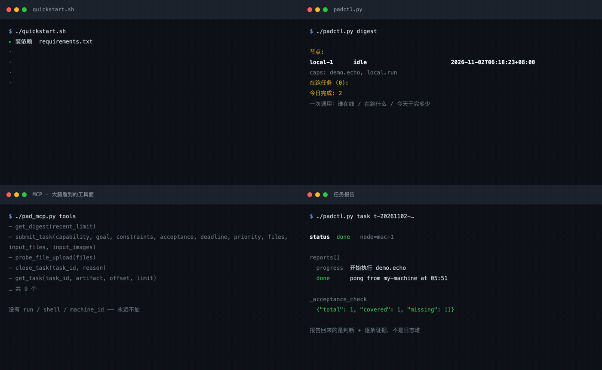
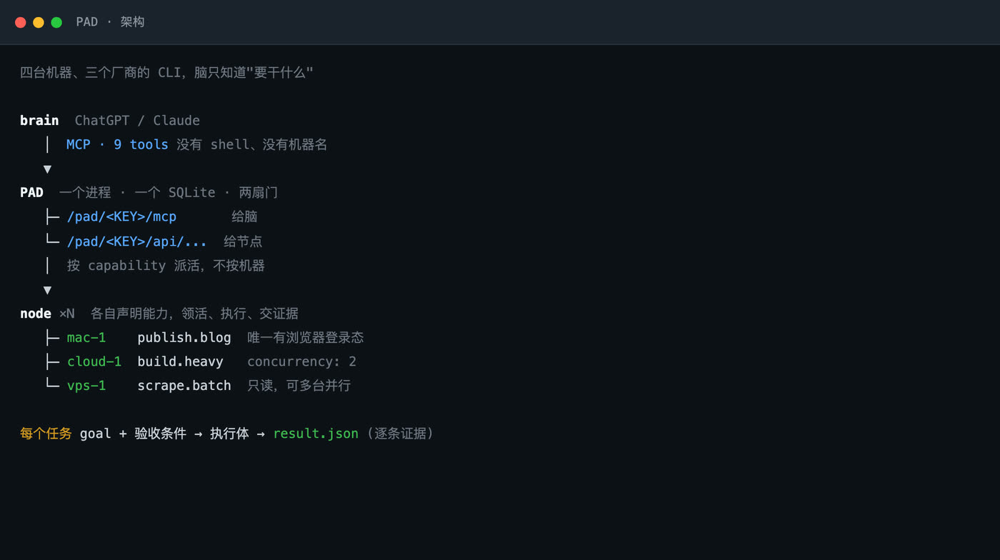
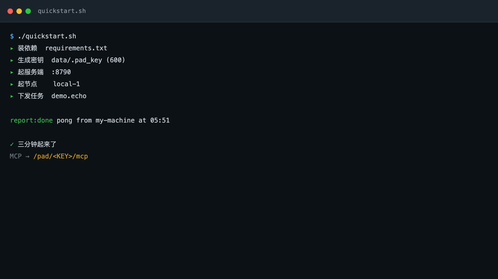
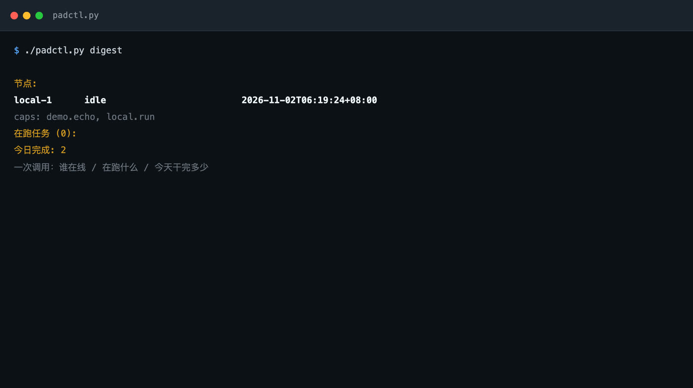
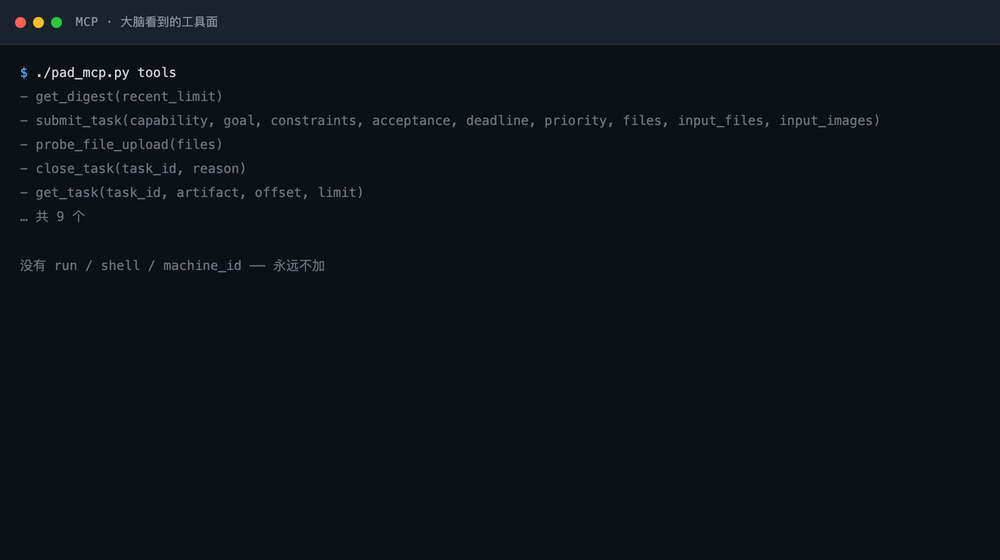

# PAD

[中文](README.md) · [English](README.en.md) · [Français](README.fr.md) · [日本語](README.ja.md) · **Русский**

**Превратите машины, которые у вас уже есть, в исполнительный флот, которым управляют ChatGPT или Claude.**
Один процесс, один файл SQLite, две двери — модель без состояния, состояние живёт в PAD.



<sub>Все четыре панели — кадры реального запуска: `./quickstart.sh`, загорающийся строка за строкой, `padctl digest`, поверхность инструментов MCP и отчёт о задаче. Сгенерировано `docs/make_preview.py` из фактического вывода этой машины, а не макет.</sub>

**Статья**: [`paper/pad.pdf`](paper/pad.pdf) — системный отчёт о 6 машинах, 938 реальных задачах и 835 машино-часах, в вёрстке ICML 2025.

---

```
/pad/<KEY>/mcp        для мозга (ChatGPT / Claude) — 9 инструментов
/pad/<KEY>/api/...    для демона каждой машины — регистрация / взятие / отчёт
```

Модель не помнит, что делала вчера, какая машина занята и где застряла задача. Не может и не
должна. PAD держит это в SQLite; модель спрашивает одно — *какая сейчас ситуация* — получает
сводку и продолжает управлять.



## Быстрый старт

```bash
git clone https://github.com/Liam-magicbook/pad.git && cd pad
./quickstart.sh
```

Меньше чем за три минуты он создаст виртуальное окружение, поставит зависимости, сгенерирует ключ,
запустит сервер, запустит локальный узел, отправит реальную задачу и покажет отчёт.



В конце вы получите URL MCP; вставьте его в ChatGPT и всё. Остановка: `./quickstart.sh --stop`.

Требования: Python 3.10+ и возможность создать venv. Ни Docker, ни сервера базы данных.

## Какую задачу это решает

У вас три вида работы на трёх машинах: Mac с состоянием браузерных сессий, облачная машина для
долгих сборок, небольшой VPS для сбора данных. Вы говорите в ChatGPT «сделай отчёт» и ждёте, что
оно само знает, куда это отправить.

**Без PAD** вы описываете состояние каждой машины в разговоре, и модель должна это запомнить.
Новая сессия — всё заново.

**С PAD** вы говорите «сделай отчёт», модель один раз вызывает `get_digest` и видит:

```
nodes:
  mac-1       running 2 [publish:12min, build:0min]
    caps: publish.blog, build.heavy
  vps-1       idle
    caps: scrape.batch
active (2):
  t-20261102-a3f2   running   publish.blog  6 постов сегодня
done today: 7
```

И отправляет в `scrape.batch`, потому что `vps-1` свободна — и **она так и не узнала имя ни одной
машины**. Машины можно добавлять, заменять и терять без единого изменения на стороне модели.



## Подключение мозга

MCP — единственная внешняя поверхность. Мозг получает девять инструментов; там нет `run`, нет
`shell`, нет `machine_id`:

```
get_digest(recent_limit=10)          состояние флота
submit_task(capability, goal, …)     отправить задачу (файлы опционально)
get_task(task_id)                    одна задача: статус + поток отчётов + артефакты
get_artifact(task_id, name, offset)  постраничное чтение артефакта
get_input_file(task_id, name)        открыть файл, отправленный с задачей
close_task(task_id, reason)          отмена (убивает локальную группу процессов)
probe_file_upload(files)             сквозная проверка пути вложений
get_artifact_delivery / observe      подписанная ссылка и выборка кадров (опционально)
```



**ChatGPT**: Settings → Connectors (Developer mode) → Create → MCP Server URL
`http://<хост>:8790/pad/<KEY>/mcp` → Scan tools → убедитесь, что инструменты появились.

**Claude Code / любой клиент MCP**:

```json
{
  "mcpServers": {
    "pad": { "type": "http", "url": "http://127.0.0.1:8790/pad/<KEY>/mcp" }
  }
}
```

Работа на localhost не значит работа из интернета. Для телефона или внешнего доступа см.
[Развёртывание](#развёртывание).

## Добавление машины

Одна машина = один узел = один YAML. **Никаких изменений в коде PAD.**

```bash
# на новой машине
export PAD_HOME=$HOME/pad-ld
BASE=http://<хост>:8790/pad/<KEY>

mkdir -p "$PAD_HOME"
curl -fsS "$BASE/agent.bundle.tgz" | tar xz -C "$PAD_HOME"
cd "$PAD_HOME"
python3 -m venv .venv && .venv/bin/pip install -r requirements.txt

cp ld_config.node.yaml.example ld_config.yaml
vi ld_config.yaml                 # node_id / capabilities / pad_url
.venv/bin/python ld_agent.py ld_config.yaml
```

Полученный `agent.bundle.tgz` — это **текущий** демон узла и промпты с сервера. Никакого клонирования
и никакого «эта машина крутит логику трёхмесячной давности». Когда скелет на сервере меняется, узлы
сообщают о несовпадении отпечатка при регистрации, и одна команда перезабирает его (не трогая ваш
`ld_config.yaml`):

```bash
curl -fsS "$BASE/agent.bundle.tgz" | tar xz -C "$PAD_HOME" && <перезапустить LD>
```

Полный протокол вступления, список самопроверок и известные ловушки — в [JOIN.md](JOIN.md).

### Два способа объявить возможность

```yaml
capabilities:

  # 1. детерминированная работа: вызвать команду
  scrape.batch:
    desc: "пакетный сбор, только чтение"
    cmd: "cd ~/projects/scraper && python3 crawl.py --out $PAD_WORK_DIR/data.json"
    timeout_min: 120

  # 2. нужна оценка: отдать локальному agent CLI без интерфейса
  build.heavy:
    desc: "тяжёлые задачи по коду"
    cmd: "python3 /opt/pad-ld/harness/run_harness.py opencode"
    timeout_min: 240
    concurrency: 2
```

`run_harness.py` переводит задачу в вызов одного из CLI — **смена исполнителя это один аргумент**:
`opencode` / `claude` / `codex`. Весь код адаптации — одна функция `build_cmd()`. PAD не знает, какую
модель вы используете; он отправляет «что должно произойти», а адаптируется узел, поэтому машины
могут различаться.

При любом способе контракт один: завершено или провалено, узел пишет `$PAD_WORK_DIR/result.json` с
`done`/`failed`, текстовым отчётом и доказательствами по каждому критерию. **Нет `result.json` —
значит не завершено**, даже при коде выхода 0.

Простой `echo` тоже может дойти до `done`, но сервер пометит приёмку как неотвеченную
(`_acceptance_check.covered=0`). Это не поломка — система честно говорит, что отчёт не может себя
доказать. Оберните в `harness/run_script.py`, чтобы получить стандартный `result.json` из stdout,
кода выхода и хвоста лога.

### Спросите это перед добавлением возможности

> Если две машины сделают это одновременно, они столкнутся?

| Ответ | Что делать |
|---|---|
| **Да** (общее состояние входа, тот же выходной файл, тот же ресурс) | Объявить может **только одна** |
| **Нет** (сбор данных, тесты, чистое чтение) | Объявить **одно и то же имя** на нескольких узлах — это горизонтальное масштабирование |

Никогда не переименовывайте конфликтующую возможность, чтобы обойти правило. Хаб сочтёт это другой
работой и отправит по одной на каждую — конфликт не исчезнет, просто спрячется.

## Развёртывание

Localhost не годится для телефона, другой сети или облака ChatGPT. Нужны три слоя:

```
интернет → обратный прокси (nginx/caddy, TLS) → 127.0.0.1:8790 (uvicorn)
```

То, что кусается (каждый пункт стоил нам сессии отладки):

| Пункт | Замечание |
|---|---|
| **`PAD_ALLOWED_HOSTS`** | Белый список MCP против DNS-rebinding, сравнение **буквально с заголовком `Host`, включая порт**. Хост вне списка даёт 421, тогда как REST продолжает отвечать 200 — диагностировать крайне тяжело |
| **`PAD_KEY`** | Это и есть аутентификация. Она в URL, поэтому считайте её долгоживущим отзываемым секретом. Не публикуйте |
| **Лимит тела в прокси** | По умолчанию мал; задачи с файлами дают 413. Поставьте `client_max_body_size 32m` для location `/pad/` |
| **Не перезапускайте сервер** | `systemctl restart pad` убивает группы процессов выполняющихся задач. Перезапускайте в тихое окно |

```bash
# сервер
PAD_KEY=$(cat data/.pad_key) \
PAD_DB=/var/lib/pad/pad.db \
PAD_ALLOWED_HOSTS=pad.example.com,localhost,127.0.0.1 \
.venv/bin/python -m uvicorn server:app --host 127.0.0.1 --port 8790
```

Юниты systemd в `deploy/pad.service` и `deploy/pad-node.service` (Linux), плюс
`deploy/com.pad.ld.plist` (macOS). Все места `CHANGE_ME` помечены.

## Отправка файлов вместе с задачей

Модель не должна впихивать мегабайты base64 в свой контекст. Два пути:

**1. `files` (вложения ChatGPT)** — пользователь прикрепляет файл в разговоре; ChatGPT преобразует
его через `_meta["openai/fileParams"]` в `{download_url, file_id, mime_type, file_name}`, и сервер
забирает байты **в рамках этого вызова**. Модель вообще не касается содержимого.

**2. `input_files`** — когда у вызывающей стороны уже есть байты: `{name, mime_type, data_base64}`.

Оба пути используют одну проверку и одно хранилище (8 файлов на задачу, ≤10 МиБ каждый, ≤15 МиБ
суммарно). Узел видит исходные файлы плюс `manifest.json` с sha256 в `inputs/`. Любой тип: картинки,
PDF, Office, CSV/JSON/Markdown, архивы, аудио, видео, субтитры.

Без ручного base64:

```bash
./padctl.py submit --capability build.heavy --goal "переработать план по этому отчёту" \
  --file ~/Downloads/квартальный-отчёт.pdf --file ~/Downloads/данные.xlsx
./padctl.py inputs t-20261102-xxxxxx          # какие файлы несёт эта задача
./padctl.py input  t-20261102-xxxxxx --out .  # скачать и проверить
```

**`download_url` действителен только во время этого вызова**, поэтому байты нужно забирать
синхронно; «сохранить URL в задаче и дать узлу забрать позже» всегда истекает. Этот путь трактуется
как SSRF: только https, DNS-резолвинг отвергает частные/loopback/зарезервированные диапазоны,
**каждый шаг редиректа перепроверяется** (автоследование отключено — иначе один 302 обойдёт блок),
и чтение считается против лимита размера.

## Сознательные решения

**Маршрутизация по возможности, а не по машине.** Модель говорит «хочу, чтобы `build.heavy` было
сделано», а не «запусти это на gpu-1». Тот, кто объявил эту возможность, её и берёт. В структуре
задачи **нет** `machine_id`, нет `command`, нет `shell` — и не будет.

**Цель — это результат, а не процедура.** Мозг и исполнитель получают одно и то же предложение:
что нужно, где граница, как оценивается завершённость. Исполнитель разбирает, исследует и проверяет;
застряв, пробует другой путь вместо вопроса «что дальше». Если действительно не может закончить —
отдаёт полный отчёт `failed`: что достигнуто, где застрял, где доказательства.

**Отмена должна доходить до плоскости исполнения.** Если `close_task` меняет только состояние в PAD,
получается «плоскость управления считает, что мертво, плоскость исполнения всё ещё работает» — слот
удерживается в заложниках, и всё за ним не может начаться. Это из реального инцидента: узлы опрашивают
статус во время выполнения и убивают всю группу процессов при `cancelled`, отказываясь подавать
опоздавший `done`.

**Тайм-аут — это не отмена.** После мягкого тайм-аута сессии потомок может всё ещё делать полезную
работу, поэтому мы трактуем это как аренду и забираем результат, если он придёт. Убивает процессы
только явный `cancelled`.

**Отчёты должны доказывать себя.** И `done`, и `failed` несут доказательства по каждому критерию;
сервер вычисляет покрытие (`_acceptance_check.missing` называет неотвеченное). Он судит только
*ответили ли на критерий*, никогда — правдив ли ответ; правда приходит от независимого узла-ревьюера.
Сырой объём остаётся локально со статистикой, но поля, явно названные отправителем, воспроизводятся
полностью.

**Скелеты устаревают, поэтому есть отпечаток.** Документы и промпты живут на сервере; узлы держат
копии, которые сами не обновляются. `bundle.py` хеширует файлы поведения и промпты, узлы сообщают
свой хеш при регистрации, и расхождение сразу видно в обзоре ситуации.

## Один PAD, три мозга: work agent и personal agent — это один слот

Слово «агент» используют для двух совершенно разных вещей, и их смешение — причина, по которой
большинство продуктов-персональных ассистентов получаются искажёнными.

- **Work agent** — ограниченные полномочия. Вы задаёте результат; он завершает внутри объявленной рамки.
- **Personal agent** — постоянные полномочия. Он сам решает, что делать, когда и какими ресурсами.

Индустрия предполагает, что этим нужны две системы. Ответ PAD: **это лишь вопрос того, какой клиент
занимает слот мозга, а не архитектурный вопрос.** Слот сменный, и хабу это безразлично.

| Кто в слоте | Полномочия | Точка входа |
|---|---|---|
| Чат-модель | Делегирование: вы просите словами, модель решает сколько задач и какие возможности | MCP `/mcp`, `created_by=chatgpt` |
| Вы сами | Напрямую: вы называете возможность и цель в командной строке | `padctl submit`, `created_by=human` |
| Планировщик | Периодически: отправляет один и тот же конвейер каждый день | внутренний таймер, `created_by=daily-auto-timer` |

Все три идут через **тот же** `submit_task`, пишут в **ту же** таблицу `tasks`, проходят **тот же**
шлюз приёмки и попадают в **тот же** digest. Ничто ниже по потоку не ветвится по `created_by`. Вот
что на самом деле значит «мозг без состояния»: **мозг — не компонент, а роль**, и её может занимать
любой клиент, удовлетворяющий протоколу.

Два месяца в продакшене, реальное распределение трёх мозгов на одном хабе:

| | Чат-модель | Вы | Планировщик |
|---|---|---|---|
| задач | 854 | 39 | 36 |
| завершено | 680 | 36 | 19 |
| провалено | 111 | 2 | 17 |
| покрытие доказательствами | 96% | 47% | 100% |
| медианная длительность | 14,6 мин | 0,7 мин | 341 мин |
| машино-часы | 632,9 | 6,9 | 194,4 |
| медианная длина goal | 301 симв. | 131 симв. | 611 симв. |
| с критериями приёмки | 98% | 79% | 100% |
| затронуто возможностей | 12 | 8 | 1 |

Эта таблица — самое твёрдое доказательство дизайна. **Три направления разделяются сразу:**

- Работа, отданная модели, **специфицирована**: цели по 301 символу, 98% с критериями, по 12 возможностям.
- Работа, отправленная вами вручную, **направлена**: цели по 131 символу, 79% с критериями, медиана
  меньше минуты, всего 6,9 машино-часов за два месяца.
- Планировщик — другая крайность: 1 возможность, самые длинные цели, **47% провалов** — фиксированный
  конвейер без присмотра, и некому заметить, что его цель сдвинулась.

**Переключение бесплатно и не требует миграции.** Из 46 активных дней 10 содержат задачи и от
чат-модели, и от вас. Понятную работу, результат которой — одна команда, вы отправляете сами; работу,
требующую исследования, декомпозиции или серии отправок, отдаёте модели. Оба пути оставляют один и
тот же след аудита, поэтому запись не раскалывается при смене режима.

**Полномочия — это вопрос степени, а не две системы.** Пруденциального work agent и распущенного
personal agent разделяет не песочница и не набор инструментов, а **какая часть рамки зафиксирована
заранее**. Одно взаимодействие `padctl` фиксирует возможность, цель и критерии, каждое поле решает
человек. У чат-модели те же девять инструментов и тот же потолок, но она отправляет несколько задач и
сама выбирает возможности — поэтому её цели более чем вдвое длиннее (301 против 131 символа). Больше
делегирования — больше спецификации.

**Больше автономии — это правка YAML, а не смена архитектуры.** Режим персонального ассистента — это
PAD плюс клиент, который часто отправляет задачи, держит долгую сессию и наделён широким списком
возможностей. Ни одна строка хаба не меняется; меняется то, **какие возможности вы объявляете**. Это
сознательное место для решения: оно остаётся явным и отзываемым, а не закопанным в промпт агента.

**Но у автономии есть цена, и данные говорят о ней прямо.** Тот же механизм, что делает переключение
бесплатным, делает чрезмерное делегирование легким: модель с широким списком возможностей охотно
отправит цель, которую ни одна возможность не может удовлетворить, и хаб добросовестно запишет
провал. Примерно половина таксономии отказов — именно такой формы. **Если бы право маршрутизации
отдали модели, эта система вообще не смогла бы построить таксономию отказов** — не было бы единого
места, где записано, что пошло не так.

## Многомашинная координация без координатора

Естественное возражение хабу: централизация означает узкое место. PAD **централизован по состоянию
и децентрализован по исполнению**, и это различие объясняет, почему шесть машин сотрудничают без
процесса-планировщика.

В хабе нет воркера очереди, он ничего не исполняет. На каждом опросе он отвечает на два вопроса:
**есть ли работа, соответствующая объявленным мной возможностям**, и **каково состояние работы,
которую я держу**. Каждый узел опрашивает в своём ритме и берёт только когда есть свободный слот.
Пропускная способность — сумма локальных решений, а не вывод глобального планировщика.

**Этапа назначения нет вообще.** Работу **забирают**, а не раздают. Таблица маршрутизации хаба —
набор объявлений, а не набор решений. Отсюда четыре свойства, и каждое убирает машину, нужную
обычному оркестратору:

- **Нет планировщика, нет консенсуса.** Работа забирается из таблицы с индексом по возможности; хабу
  не нужен глобальный обзор нагрузки и не нужно согласие о том, кто что делает. Добавить машину —
  регистрация; убрать — тайм-аут.
- **Обратное давление автоматическое.** Узел, объявивший `concurrency: N`, не возьмёт (N+1)-ю задачу.
  Очередь растёт в базе данных — там, где её видно, — а не в памяти брокера.
- **Отказ локализован.** Узел, умерший в середине задачи, оставляет её в `running` до истечения аренды;
  отчёты пишутся только на добавление и идемпотентны, поэтому следующий держатель этой возможности
  продолжает из журнала, а не из останков процесса.
- **Запись координации и есть запись аудита.** Каждое взятие, отчёт и артефакт — это строка. Поэтому
  таксономия отказов не потребовала дополнительной инструментации: данные, которые планировщик хранил
  бы для себя, — те же данные, которые нужны аудитору.

Цена реальна и названа прямо: один хаб — единая точка координации, и перезапуск теряет надзор за
процессами выполняющихся задач. Для одного оператора с несколькими машинами сделка явно верна; для
мультитенантности — нет, и PAD на это не претендует.

## Структура репозитория

| Файл | Назначение |
|---|---|
| `server.py` | Сервер (FastAPI + MCPServer + SQLite); обе двери |
| `db.py` / `schema.sql` | Слой состояния |
| `ld_agent.py` | Демон узла на каждой машине |
| `harness/run_harness.py` | Переводит задачу в вызов opencode / claude / codex без интерфейса |
| `harness/run_script.py` | Оборачивает команду в контракт PAD (для детерминированной работы) |
| `harness/prompt.md.tmpl` | Промпт исполнителя. Правила меняются только здесь |
| `padctl.py` | Человеческий CLI (умеет `--file`) |
| `pad_mcp.py` | Отладочный клиент через MCP (тот же путь, что у мозга) |
| `quickstart.sh` | Запуск одной командой |
| `contract.md` | Контракт: основа отправки, формат отчёта, дисциплина исполнения |
| `JOIN.md` | Протокол вступления + самопроверки + список ловушек |
| `CHANGELOG.md` | Изменения поведения; при отладке смотреть первым |
| `docs/make_preview.py` | Пересборка hero-GIF (реальный вывод → кадры → ffmpeg) |
| `paper/` | Системный отчёт (вёрстка ICML, `pad.pdf`) + только агрегаты |
| `tools/collect_stats.py` | Забрать детали задач из живого PAD и воспроизвести числа статьи |

## Разработка

```bash
.venv/bin/python -m unittest discover -s tests -v   # юнит-тесты
bash tests/e2e_input_files.sh                       # сквозной: временный сервер + узел, реальный путь
```

Демо-изображения не собираются руками; они захватывают реальный вывод этой машины, а затем
фотографируются. Перезапускать после изменения формата вывода:

```bash
./quickstart.sh          # локальный PAD должен работать
.venv/bin/python docs/make_preview.py
```

## Статья

`paper/pad.pdf` (вёрстка ICML 2025, 8 страниц основного текста + 5 приложения) превращает всё
вышесказанное в цитируемый системный отчёт: постановка задачи, связь с работами по harness /
long-horizon / делегированию, архитектура, принципы дизайна и измерения. Приложение подробно
разбирает схему БД, состояние задачи, контракт каждого из девяти инструментов и скрипты
воспроизведения. Публикуется только готовый PDF; исходники LaTeX остаются локально.

Измерения получены из двух месяцев реальных логов этой системы в продакшене:

| Метрика | Значение |
|---|---|
| Узлы / возможности | 6 машин, 20 возможностей, agent CLI трёх вендоров |
| Реальные задачи (без самопроверок) | 938, 835 машино-часов |
| Долгие задачи | 18,7% дольше часа, 25 дольше 6 часов, самая долгая 42 часа |
| Доказательства по критериям на завершённых | 93% |
| Проваленные задачи, всё равно давшие структурный отчёт | 42% |
| Главная причина отказов | 64 из 132 — сбои окружения исполнителя, а не модели |

Последняя строка — то, что доказывает весь дизайн: **большинство отказов происходит в окружении, а не
в рассуждении.** Harness с одним циклом видит «вызов инструмента сломался»; PAD видит «эта возможность
на этой машине сломана», и именно второе можно починить.

Данные и скрипты воспроизведения: `paper/data/aggregates.json` и `tools/collect_stats.py`. Сырой дамп
содержит реальные цели оператора и в репозиторий не входит.

## Известные пробелы

- Аутентификация — ключ в URL, без OAuth. Переход на OAuth означает замену слоя перед прокси; контракт не меняется
- Задача, упавшая в середине `running` (без терминального отчёта), не подхватывается автоматически; нужен stale reaper
- Лимит 10 МиБ на файл происходит из буферизации в памяти сервера; сотни МБ потребуют дозаписи частями
- Неподдерживаемые не-картинки не разбираются внутри PAD (нет извлечения текста PDF, нет конвертации Office); исполнитель узла читает их локальными инструментами
- Публикация в рабочее пространство ChatGPT Business/Enterprise не реализована; только личный developer mode

---

MIT License
