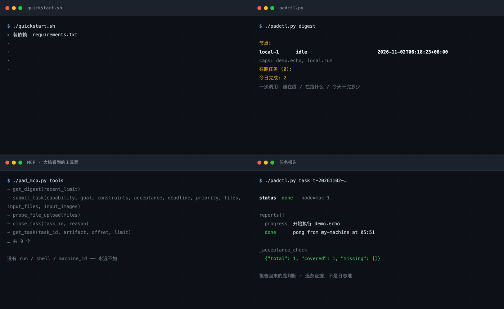
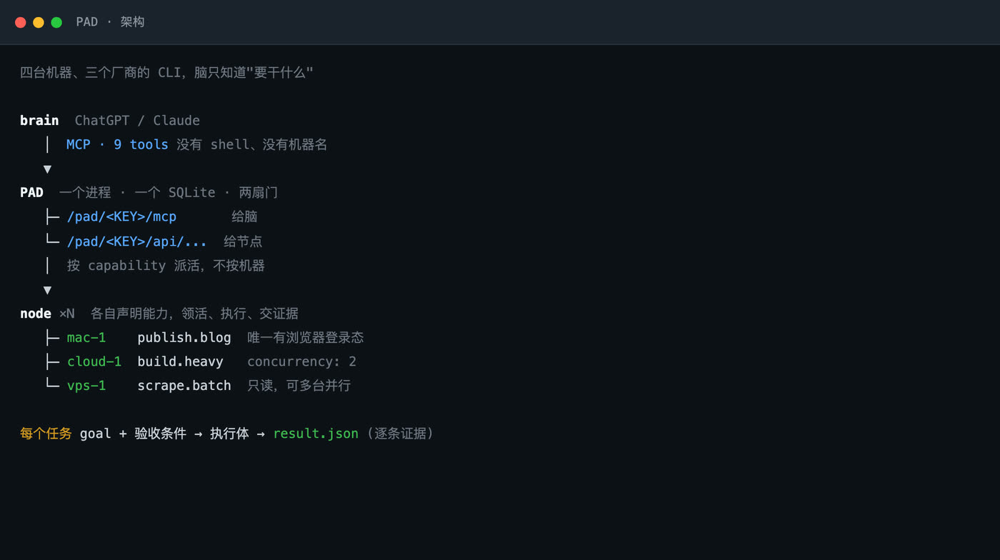
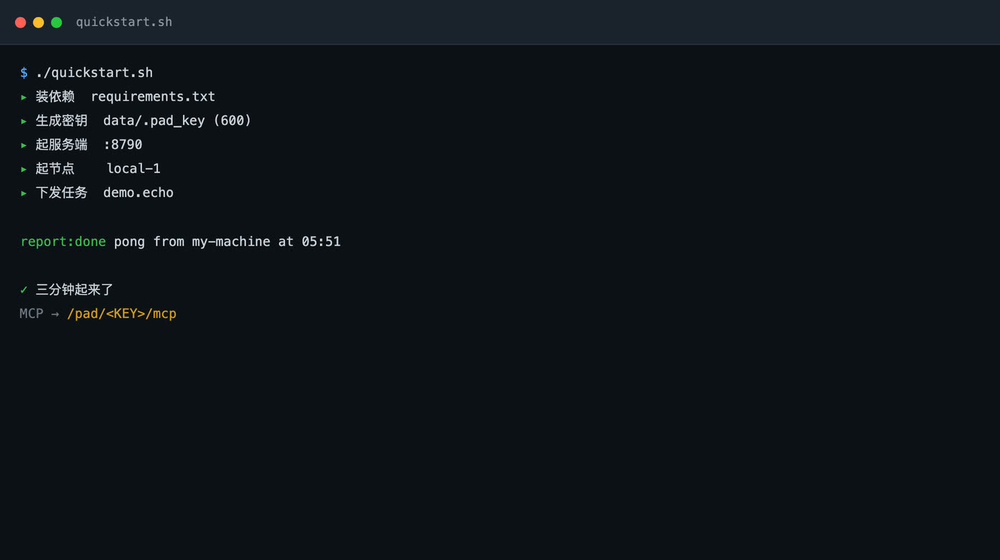
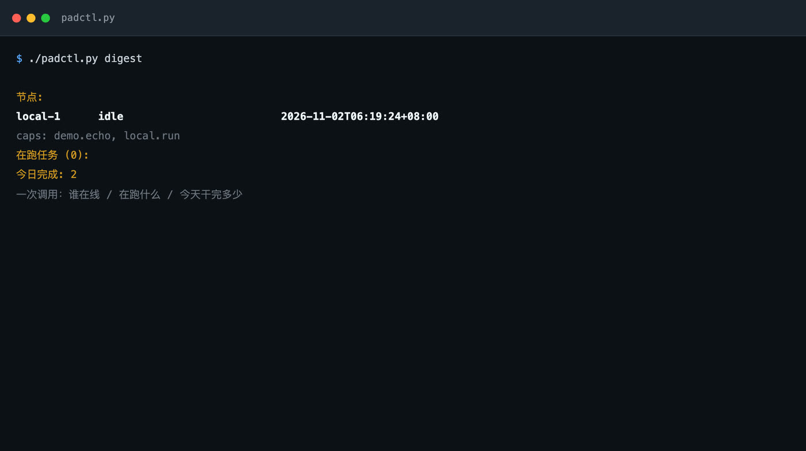
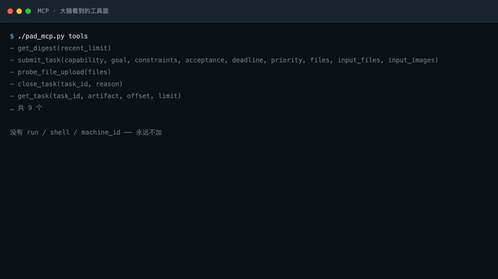

# PAD

**中文** · [English](README.md) · [Français](README.fr.md) · [日本語](README.ja.md) · [Русский](README.ru.md)

**一个 brain，指挥很多台机器上的活。状态在中间，不在谁的脑子里。**

一个进程，一个 SQLite，两扇门。



<sub>四格都是真实运行的截帧。由 `docs/make_preview.py` 从真实输出生成，不是设计稿。</sub>

---

## PAD 不是 agent

这一点先说清楚，不然后面全会理解错。

```
ChatGPT / Claude  (brain)   ← 无状态，只发目标和读结果
        ↘
          PAD               ← 不做智能。只管任务状态、路由、证据
        ↙
  节点 × N  (每台机器一个)   ← 真正干活，各自声明自己能干什么
```

**PAD 自己不会思考，也不会干活。** 它做三件事：

- 记住谁在干什么、干到哪了（任务状态）
- 把活派给声明了对应能力的节点（路由）
- 保存每一份报告和证据（账本）

brain 是外部的 ChatGPT 或 Claude，也可以是你自己的命令行。它**每次都是新的**，不记得昨天做了什么。

这就是 PAD 存在的理由：**brain 记不住的东西，PAD 替它记住；brain 看不见的机器，PAD 替它调度。**

## 为什么这很重要

普通 agent 是**一个会话里的一个模型**。它的能力上限，取决于那个会话的上下文能装下多少东西。

- 换个会话 → 失忆，重新解释一遍
- 换台机器 → 不知道那台机器上有什么、能不能干
- 加个新工具 → 上下文更挤，很快就装不下了

PAD 把状态从会话里搬出来，于是：

- **brain 可以指挥它从没见过的机器。** 它不知道机器名，只声明"这件事要完成"，PAD 路由给有能力的那台。换机器、加机器、机器挂了，brain 一行都不用改。
- **多个节点同时干活，目标不会各走各的。** 它们的输入来自同一份任务定义，输出回到同一本账。
- **你掌握的是全局长上下文。** 一条 `get_digest` 就是全部节点的状态，不是某一个会话的视角。



## 一个 brain 可以管控不同种类的活

这是 PAD 真正的能力。

传统做法里，每类活各配一个 agent，彼此不共享状态，你得在中间传话——把上一步的产出、约束、进度逐个复述给下一个。agent 越多，人越累。

PAD 不是这样。**路由键是 capability，不是机器名，也不是 agent 身份。**

```
              中枢：任务 / 状态 / 证据 / 历史
                            │
        ┌───────────────────┼───────────────────┐
   capability A        capability B        capability C
   node 1, node 2      node 3              node 4, node 5
   高并发              独占资源             长时后台
```

同一个 brain，同一套 9 个工具，就能同时驱动**类型完全不同的工作**。它不知道每件事由谁做、在哪台机器上做、用什么工具做——它只声明要什么，PAD 把活路由给声明了那个能力的节点。

**这才是"多机"的意义：不是并发更多，而是一个 brain 能指挥的工作种类更多，而且状态统一。**

这些活互相隔离：一台机器上的失败不会污染另一台，一个能力的超时不会拖垮其他任务。

## 同一个中枢，两种用法

**管控模式**和**自动模式**，是同一个系统的两个配置。

| | 管控 | 自动 |
|---|---|---|
| 谁下命令 | 人在命令行点名能力和目标 | brain 自己决定发几个任务、挑哪些能力 |
| 约束强度 | 每个字段由人钉死 | 能力清单由人声明，其余交给 brain |
| 适合什么 | 结果明确、验收严格 | 调研、拆解、需要连续多轮 |
| 切换成本 | 改一行 YAML | 改一行 YAML |

**两种模式写同一张表、过同一套验收闸门、出现在同一份态势里。** 下游没有任何一处分支。从管控切到自动，不需要迁移，审计记录不会断成两截。

这就是"决策权留在人手上"的真实含义：**不是不许它自主，而是自主的边界由你声明、随时可收回。**

实测（同一 hub，生产环境两个月）：

| | brain 驱动 | 人直接下命令 | 定时器 |
|---|---|---|---|
| 任务数 | 854 | 39 | 36 |
| 证据覆盖 | 96% | 47% | 100% |
| 中位时长 | 14.6 分钟 | 0.7 分钟 | 341 分钟 |
| goal 中位长度 | 301 字 | 131 字 | 611 字 |
| 触及能力数 | 12 | 8 | 1 |

交给 brain 的是**被规格化的**活（goal 长、带验收条件、散在多个能力上）；人直接发的是**被定向的**短命令。两种模式在同一本账上分得清清楚楚。

## 它解决什么

| 问题 | PAD 的答案 |
|---|---|
| 换个会话就失忆，上下文装不下 | 状态在 SQLite，不在会话里。brain 每次重新读一遍就行 |
| brain 不知道机器上有什么、能不能干 | capability 表。brain 只声明要什么，PAD 路由 |
| 加台机器就要改 prompt、改代码 | 加机器是注册一个 YAML，brain 侧零改动 |
| 多个 agent 各自为政，目标漂移 | 同一份任务定义进，同一本账出 |
| 说"做完了"但拿不出证据 | 完成必须逐条回答验收条件，否则算未回答 |

## 三种模式的差别

Personal Agent 和 Work Agent 指两类典型工作模式，不是所有同类产品都严格符合这些限制。

| 维度 | Personal Agent | Work Agent | **PAD** |
|---|---|---|---|
| 核心定位 | 持续辅助个人 | 完成具体工作 | **管理持续运行的工作体系** |
| 主要输入 | 个人偏好、信息、事件 | 明确任务与材料 | **信息流、目标、任务与反馈** |
| 主动性 | 较高 | 以任务为中心 | **信息主动，执行可控** |
| 执行方式 | 自主跟进和行动 | 单次或多步执行 | **多 Agent、多节点协同** |
| 上下文 | 偏个人长期记忆 | 偏任务上下文 | **任务状态与项目历史** |
| 决策方式 | Agent 较多自主判断 | 用户定义目标 | **人掌握方向，Agent 辅助判断** |
| 核心价值 | 不错过重要信息 | 把事情做完 | **持续把有价值的信息转化为产出** |

```
信息层 · Personal Agent
  持续收集、筛选、排序有价值的信息
        ↓  「这里有几件事，值得你看看」
决策层 · 你 + PAD
  判断什么值得做，定义目标与优先级
        ↓  「把这件事做成这样，验收标准是这些」
执行层 · Work Agents
  开发、内容生产、研究、部署、分发
        ↓  「做完了，证据在这，卡住的地方在这」
反馈层 · 任务状态与产物
  运行记录、成果、问题、下一轮调整
```

**关键在第二个箭头。** 全自主 Agent 把"发现值得关注的事"和"决定立刻执行"混成一步：看见一个新东西，就自行部署、改代码、加功能，最后产出一堆没人要的成果。PAD 把这两件事拆开——而且是架构上拆开，不是靠 prompt 里写"请先询问用户"。

## 还有三点

**任务是持续存在的工作对象，不是一次性的对话。** 普通 Work Agent 的交互是「提出任务 → 执行 → 返回结果 → 结束」。PAD 让任务脱离单次会话：按既定流程启动，状态和结果由中枢管理。看到的是连续的任务流，不是一堆断掉的对话。

**探索和生产必须用不同标准。** 探索要广泛覆盖、有信息增量；生产要范围明确、结果可控。混在一起就会出现那个熟悉的失败模式——执行过程中看见一个新想法，不断加规则、加功能、加工作量，最后偏离真正的目标。PAD 让它们走不同入口、不同节点配置、不同验收标准。

**核心资产是会积累的工作体系。** 普通 Agent 的能力来自模型本身，换个模型能力重置。PAD 积累的是节点分工、任务记录、项目经验、可复用的执行方式。模型是引擎，体系是车。

---

## 那就跑起来吧

### 一键起步

```bash
git clone https://github.com/Liam-magicbook/pad.git && cd pad
./quickstart.sh
```

三分钟以内，它会：建虚拟环境 → 装依赖 → 生成密钥 → 起服务端 → 起一台本地节点 → 打一个真任务 → 把任务报告打出来。



跑完会拿到一个 MCP 地址，填进 ChatGPT 就能用了。停掉：`./quickstart.sh --stop`。

要求：Python 3.10+、能建 venv。没有其他依赖，不需要 Docker、不需要数据库服务。

### 两扇门

```
/pad/<KEY>/mcp        给 brain（ChatGPT / Claude）—— 9 个任务管理与报告读取工具
/pad/<KEY>/api/...    给每台机器的节点守护进程 —— 注册 / 领活 / 进度与最终报告
```

brain 不需要记得昨天干了什么、哪台机器在跑什么、任务卡在哪一步——这些它记不住，也不该记。PAD 把它们放进 SQLite，brain 每次只问一句"现在什么情况"，拿到一份摘要，继续往下指挥。

说一句"出一份报告"，brain 调一次 `get_digest`，看到：

```
节点:
  mac-1       running 2 [build:12min, test:0min]
    caps: build.heavy, test.suite
  vps-1       idle
    caps: scrape.batch
在跑任务 (2):
  t-20261102-a3f2   running   build.heavy   重编 6 个目标
今日完成: 7
```

然后它派活到 `scrape.batch`，因为 `vps-1` 正好空着——而**它从来不需要知道机器名**。



---

# 技术细节

下面是这份东西怎么搭起来的。只想用的话，上面部分就够了。

## 接进大脑

PAD 对外的唯一入口是 MCP。给 brain 的工具只有 9 个，没有 `run`、没有 `shell`、没有 `machine_id`：

```
get_digest(recent_limit=10)          全局态势：谁在线、在跑什么、今天完成多少
submit_task(capability, goal, …)     下发任务（可带文件）
get_task(task_id)                    单任务：状态 + 汇报流 + 产物清单
get_artifact(task_id, name, offset)  打开产物看正文（分页）
get_input_file(task_id, name)        打开随任务下发的文件
close_task(task_id, reason)          取消任务（会真的杀本地进程）
probe_file_upload(files)             文件通路自检
get_artifact_delivery / observe      产物直链与抽帧（可选扩展）
```



**ChatGPT**：Settings → Connectors（Developer mode）→ Create → MCP Server URL 填
`http://<你的主机>:8790/pad/<KEY>/mcp` → Scan tools → 确认出现上面这些工具。
新开一个对话，在工具菜单里启用 PAD。

**Claude Code / 其他 MCP 客户端**：

```json
{
  "mcpServers": {
    "pad": { "type": "http", "url": "http://127.0.0.1:8790/pad/<KEY>/mcp" }
  }
}
```

本机试通了不代表外网能用。要让手机或别的网络访问，见 [部署到公网](#部署到公网)。

## 谁坐在 brain 槽位上

brain 是可替换的。同一个 hub，三种客户端，走**同一个** `submit_task`、写**同一张** `tasks` 表、过**同一套**验收闸门：

| 谁 | 授权方式 | 入口 |
|---|---|---|
| 聊天模型 | 转授：用自然语言提要求，模型自己决定发几个任务、挑哪些能力 | MCP `/mcp`，`created_by=chatgpt` |
| 人 | 直接：在命令行点名能力和目标 | `padctl submit`，`created_by=human` |
| 定时器 | 周期：每天同一时间发同一条流程 | 内部 timer，`created_by=daily-auto-timer` |

下游没有任何一处按 `created_by` 分叉。**brain 不是一个组件，是一个角色**，任何满足协议的东西都能坐上去。

生产环境两个月，同一个 hub 上三种 brain 的真实分布：

| | 聊天模型 | 本人操作 | 定时器 |
|---|---|---|---|
| 任务数 | 854 | 39 | 36 |
| 完成 | 680 | 36 | 19 |
| 失败 | 111 | 2 | 17 |
| 证据覆盖 | 96% | 47% | 100% |
| 中位时长 | 14.6 分钟 | 0.7 分钟 | 341 分钟 |
| 机时 | 632.9 | 6.9 | 194.4 |
| goal 中位长度 | 301 字 | 131 字 | 611 字 |
| 带验收条件 | 98% | 79% | 100% |
| 触及能力数 | 12 | 8 | 1 |

**三个方向同时分得开**：

- 交给模型的活是**被规格化的**：goal 长 301 字，98% 带验收条件，散在 12 个能力上。
- 人手直接发的活是**被定向的**：goal 131 字、79% 带条件、中位不到 1 分钟。
- 定时器在另一个极端：只有 1 个能力、goal 最长、**失败率 47%**——无人值守的固定流程，没有人会发现它的目标已经漂移了。

**切换零成本、不需要迁移。** 46 个活跃日里，有 10 天同时出现聊天模型和人手发的任务。

**要给它更多自主权，是改 YAML，不是改架构。** hub 一行都不用改，改的是**声明了哪些能力**。把授权决定留在这个位置是有意的：它保持显式、可撤销，而不是埋进 prompt 里。

**但自主权有代价。** 让切换零成本的同一个机制，也让过度委派变得容易：一个拿着宽能力清单的模型，会很乐意提交一个没有任何能力满足得了的目标，hub 老老实实记一笔失败。失败分类里约一半是这种形状。

## 多机协调，但没有协调者

PAD **状态集中、执行分散**，这个区分才是多台机器不需要一个调度进程就能协作的原因。

hub 里没有任何队列 worker，它自己不执行任何任务。每次轮询它只回答两个问题：**有声明过的能力对应的活吗**、**手上这些活是什么状态**。每个节点按自己的节奏轮询、有空槽才领。

**系统里根本没有"分配"这一步。** 任务是**被领走的**，不是被派下去的。hub 的路由表是一堆声明，不是一堆决策。四个性质随之而来：

- **没有调度器，没有一致性协议。** 活从一张按能力索引的表里领，hub 不需要全局负载视图。加机器是注册，减机器是超时。
- **背压是自动的。** 声明 `concurrency: N` 的节点不会去领第 N+1 个。队列长在数据库里——这才是一个可见的位置。
- **失败是局部的。** 节点中途死掉，任务留在 `running`、lease 到期；报告是追加式且幂等的，下一个拿到这个能力的节点从账本接着做。
- **协调记录就是审计记录。** 每次领取、每份报告、每个产物都是一行。失败分类不需要额外埋点。

代价是真的，说在明处：一个 hub 就是单点协调，重启会丢掉在途任务的进程监管。单操作者、几台机器，这笔交易明显划算；多租户场景不划算，PAD 也不做这个声称。

## 加一台机器

一台机器 = 一个节点 = 一个 YAML。**不需要改 PAD 一行代码。**

```bash
# 在新机器上
export PAD_HOME=$HOME/pad-ld
BASE=http://<你的主机>:8790/pad/<KEY>

mkdir -p "$PAD_HOME"
curl -fsS "$BASE/agent.bundle.tgz" | tar xz -C "$PAD_HOME"
cd "$PAD_HOME"
python3 -m venv .venv && .venv/bin/pip install -r requirements.txt

cp ld_config.node.yaml.example ld_config.yaml
vi ld_config.yaml                 # 改 node_id / capabilities / pad_url
.venv/bin/python ld_agent.py ld_config.yaml
```

`curl` 回来的 `agent.bundle.tgz` 是**服务端当前那份**节点守护与提示词——不用 clone 仓库，也不会有"这台跑的是三个月前的逻辑"。服务端改了骨架，节点注册时会收到指纹不一致的警告，一条命令重拉即可（不动 `ld_config.yaml`）。

详细的接入协议、自查清单、以及**踩过的坑**在 [JOIN.md](JOIN.md)。

### 能力的两种写法

```yaml
capabilities:

  # ① 确定性活：直接调一条命令
  scrape.batch:
    desc: "批量抓数据，只读"
    cmd: "cd ~/projects/scraper && python3 crawl.py --out $PAD_WORK_DIR/data.json"
    timeout_min: 120

  # ② 需要判断的活：交给本机 agent CLI 无头跑
  build.heavy:
    desc: "跑重型代码任务"
    cmd: "python3 /opt/pad-ld/harness/run_harness.py opencode"
    timeout_min: 240
    concurrency: 2
```

`run_harness.py` 把任务翻译成某个 CLI 的调用，**换执行体只是换一个参数**：`opencode` / `claude` / `codex`。PAD 本身不知道你用什么模型——它只发"要干什么"，适配在节点这边，所以每台机器可以不一样。

无论哪种写法，收口都是同一个：任务完成或失败，都在 `$PAD_WORK_DIR/result.json` 里写 `done` / `failed`、一段验收说明书、以及逐条验收条件的证据。**没有 `result.json` 就不算完成**，退出码 0 也不行。

### 加能力之前先问一句

> 两台机器同时干这件事，会互相踩吗？

| 答案 | 怎么做 |
|---|---|
| **会踩**（要用账号登录态、写同一份文件、抢同一个资源） | **只有一台**可以声明 |
| **不会踩**（抓数据、跑测试、纯读） | 多台都声明**同一个名字**，这才叫并行扩容 |

绝对不要为了绕开冲突给同一个活起个新名字——上层会当成两件不同的活，照样各派一份。

## 设计原则：每个选择挡的是哪种失败

机制在论文第 3 节，这里写的是**为什么**。

**状态必须比产出它的进程活得久。** 长任务系统里有两个必死的进程：上下文窗口和执行体。主流做法是把上下文做大——更长的 transcript、摘要、跨轮检索——把上下文当成存储用。它不是存储：没有淘汰策略、没有 schema、没有查询语言、不能共享、没有审计痕迹，而且它恰恰最可能在任务变长的那一刻被截断。PAD 把每个持久事实放在平均无故障时间最长的层：一个进程、一个 SQLite、只追加。

**接口必须比能力窄。** harness 靠加工具长大。每个工具局部合理、全局昂贵：要记的更多、攻击面更大、工具之间相互作用会生出新的失败模式。九个不是为优雅挑的预算，而是能通过"这是 brain 需要，还是执行体本来就有"这个问题的那些。一切作用于世界的操作——shell、文件系统、浏览器、网络、凭据——都属于执行体。brain 只拿到作用于**工作**的操作。

**按 what 路由，永不按 where。** 一旦派发指令里写了机器名，三件事同时成立：派发方必须了解舰队、舰队不能再变动、审计记录的是机器而不是意图。

**边缘比中心更了解自己的环境。** 指定步骤的派发，是派发方在声称自己了解执行环境。这通常是假的：CLI 要不要 `--skip-git-repo-check`、仓库干不干净、cookie 过没过期、磁盘够不够——全都只有边缘看得见。

**证据是产物，不是断言。** 用退出码当完成信号，在"命令即目标"时够用，在"产出一份经过核实的汇总"时毫无意义——那件事没有退出码。而且执行命令的那个系统，恰恰是最没资格判断目标是否达成的系统。

**失败是一等结果。** 大多数 harness 里失败是异常：循环中断、打印堆栈、人来读。长任务里这个形状是错的——跑了四小时发现目标按原样无法达成，它产出了结论，把它当错误丢掉就是把结论丢掉了。

**刻意没做的东西**（完整理由见论文附录 A）：hub 里不放 planner；不加消息总线或向量库；不允许任务中途对话；不做多租户；路由路径里不放模型。

## 部署到公网

本机 `127.0.0.1` 只够自己玩。要让手机、别的网络、或者 ChatGPT 的云端访问，需要三层：

```
公网 → 反代(nginx/caddy, TLS) → 127.0.0.1:8790 (uvicorn)
```

要点（每一条都踩过）：

| 事项 | 说明 |
|---|---|
| **`PAD_ALLOWED_HOSTS`** | MCP 的 DNS-rebinding 白名单，**逐字匹配 `Host` 头（含端口）**。反代送来的 host 不在白名单 → 421，而 REST 接口照常 200，极难排查 |
| **`PAD_KEY`** | 就是认证。URL 里带着它，等于一把可撤销的长期密钥。别贴公开场合 |
| **反代 body 上限** | 默认很小，带文件的任务会 413。`/pad/` 这个 location 单独提到 `client_max_body_size 32m` |
| **别重启服务端** | `systemctl restart pad` 会打断正在跑的任务（进程组跟着死）。要重启挑空窗 |

```bash
# 服务端
PAD_KEY=$(cat data/.pad_key) \
PAD_DB=/var/lib/pad/pad.db \
PAD_ALLOWED_HOSTS=pad.example.com,localhost,127.0.0.1 \
.venv/bin/python -m uvicorn server:app --host 127.0.0.1 --port 8790
```

systemd 单元在 `deploy/pad.service`，节点守护在 `deploy/pad-node.service`（Linux）和 `deploy/com.pad.ld.plist`（macOS）。

## 随任务下发文件

模型不能把几 MB 的 base64 塞进上下文。所以有两条路：

**① `files`（ChatGPT 附件直传）**——用户在对话里传了附件，ChatGPT 通过 `_meta["openai/fileParams"]` 换成 `{download_url, file_id, mime_type, file_name}`，服务端**在本次调用内**自己取回字节，模型完全不碰内容。

**② `input_files`**——调用方已拿到字节时用，`{name, mime_type, data_base64}`。

两条路共用同一套校验落盘（每任务 8 个、单个 ≤10 MiB、合计 ≤15 MiB），节点领到任务后在 `inputs/` 下看到原文件 + `manifest.json`（含 sha256）。类型不限：图片、PDF、Office、CSV/JSON/Markdown、压缩包、音视频、字幕。

命令行不想手搓 base64：

```bash
./padctl.py submit --capability build.heavy --goal "按这份报告改方案" \
  --file ~/Downloads/报告.pdf --file ~/Downloads/数据.xlsx
./padctl.py inputs t-20261102-xxxxxx          # 这个任务带了哪些文件
./padctl.py input  t-20261102-xxxxxx --out .  # 下载回来核对
```

**`download_url` 只在本次调用期间有效**，所以必须同步取字节。这条通路按 SSRF 处理：只允许 https、DNS 解析后拒绝内网/回环/保留地址、**每一跳重定向重新校验**、边读边计数超限即断。

## 目录

| 文件 | 作用 |
|---|---|
| `server.py` | 服务端（FastAPI + MCPServer + SQLite），两扇门都在这 |
| `db.py` / `schema.sql` | 状态层 |
| `ld_agent.py` | 每台机器跑的节点守护进程 |
| `harness/run_harness.py` | 把任务翻译成 opencode / claude / codex 的无头调用 |
| `harness/run_script.py` | 把一条命令收敛成 PAD 契约（确定性活用它） |
| `harness/prompt.md.tmpl` | 执行体提示词。改规矩只动这里 |
| `padctl.py` | 人用的 CLI（也有 `--file`） |
| `pad_mcp.py` | 走 MCP 端点的调试工具（和 brain 同一条路） |
| `quickstart.sh` | 一键起步 |
| `contract.md` | 契约：下发基准、汇报格式、执行纪律 |
| `JOIN.md` | 新机器接入协议 + 自查清单 + 排坑表 |
| `CHANGELOG.md` | 改完之后行为不一样的事，排查先看这里 |
| `docs/make_preview.py` | 重新生成首屏动图（真实输出 → 逐帧截图 → ffmpeg） |
| `paper/` | 系统报告（`pad.pdf`，ICML Template）+ 只含聚合的实测数据 |
| `tools/collect_stats.py` | 从线上 PAD 抓任务详情，复现论文里的数字 |
| `README.zh.md` | 中文版（默认展示的是英文 `README.md`） |

## 开发

```bash
.venv/bin/python -m unittest discover -s tests -v   # 单测
bash tests/e2e_input_files.sh                       # 端到端：起临时服务端+节点，走真链路
```

演示图不是手拼的，是捕获真实输出再截图。改了输出格式就重跑：

```bash
./quickstart.sh          # 先有一个跑着的本地 PAD
.venv/bin/python docs/make_preview.py
```

## 论文

`paper/pad.pdf`（ICML Template，正文 8 页 + 附录 5 页）把上面这些设计写成了可引用的系统报告：问题定义、与 harness / long-horizon / delegation 三支工作的关系、架构、设计原则、以及实测。附录逐项展开数据库 schema、任务状态机、九个工具的契约、以及复现脚本。

实测部分用的是这套系统在生产环境跑了两个月之后的真实日志：

| 指标 | 数值 |
|---|---|
| 节点 / 能力 | 6 台机器、20 个能力、3 个厂商的 agent CLI |
| 真实任务（不含自检） | 938 个，835 机时 |
| 长任务占比 | 18.7% 超过 1 小时，25 个超过 6 小时，最长 42 小时 |
| 完成任务的逐条验收证据 | 93% |
| 失败任务仍交结构化报告 | 42% |
| 失败主因 | 64/132 是执行体环境问题（不是模型不会做） |

最后一行是整套设计最想说明的事：**大部分失败发生在环境里，不在推理里**。单环 harness 看到的是"工具调用挂了"，PAD 看到的是"这台机器的这个能力一直挂"，后者才是能修的那个。

数据与复现脚本在 `paper/data/aggregates.json` 和 `tools/collect_stats.py`。原始抓取含 operator 的真实 goal 文本，不进仓库。

## 已知缺口

- 认证是 URL 里的密钥，没有 OAuth。换 OAuth 只需换反代前面那层，契约不动
- `running` 中途崩溃（没交最终报告）的任务不会被自动接管，需要一个 stale reaper
- 单文件 10 MiB 上限来自"服务端内存里整块收"；要发几百 MB 得分片落盘
- 非图片输入不在 PAD 内解析（不做 PDF 抽文/Office 转换），交给节点执行体用本机工具读
- ChatGPT Business/Enterprise 的 workspace 发布路径没做，只做了个人 developer mode

---

MIT License
